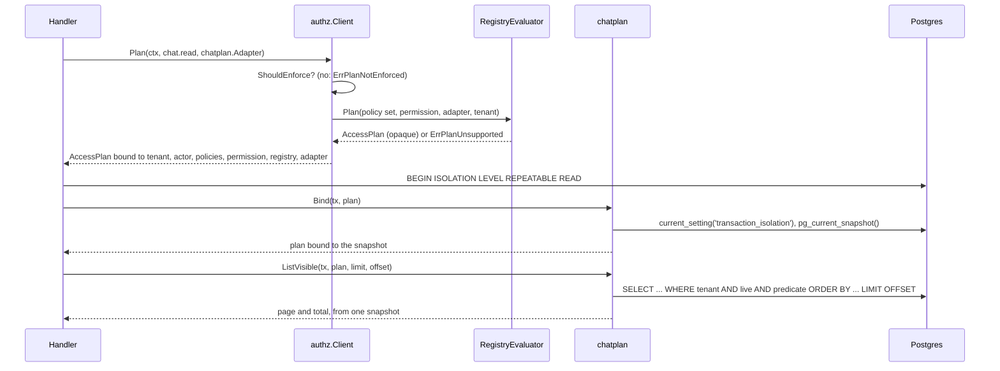

# Access plans

An access plan turns one registry permission into a SQL predicate. A collection can then list exactly the rows a point decision would allow, without deciding each row in Go. The plan lives in `server/internal/authz/access_plan.go`. The first query adapter is `server/internal/chat/chatplan`.

Nothing in production uses a plan yet. Wiring the chat list onto it is C3, and the chat contract in `docs/rbac-chat-collections.md` lists the decisions that must be settled first.

## How a plan is built and used

## What a plan can express

A plan compiles every node of the permission or refuses the whole permission with `ErrPlanUnsupported`. Nothing is partly translated.

| Node                                 | SQL                                                                                                                                                                                                      |
| ------------------------------------ | -------------------------------------------------------------------------------------------------------------------------------------------------------------------------------------------------------- |
| Grant relation                       | `TRUE` when a grant covers every instance, `FALSE` when none applies, otherwise `id = ANY($n)` over the IDs grants name. Each candidate ID is checked by the evaluator itself, so matching never drifts. |
| Authorship (`Is`)                    | `COALESCE(column = $actor, FALSE)`. A non-user actor or an empty actor ID is `FALSE`.                                                                                                                    |
| Guards                               | `IS NULL`, `IS NOT NULL`, `IS NULL OR = ''`, and `IS FALSE` on a non-nullable column. A nullable boolean is refused, because the evaluator cannot decide it when absent.                                 |
| Relationship presence                | `EXISTS` over the adapter's join.                                                                                                                                                                        |
| One relationship hop (`Via`)         | `EXISTS` over the join, with the target permission compiled on the target's columns. A second hop is refused.                                                                                            |
| Union, reused permission, difference | `OR`, inlined, and `base AND NOT subtracted`.                                                                                                                                                            |
| Several policies (live, captured)    | `AND`, since every policy must allow.                                                                                                                                                                    |

Refused: block precedence (`ExcludedBy`), permissions whose scopes take dimensions, auth-client types (represented policies apply), facts or relationships the adapter does not map, and permissions the evaluator itself does not support.

Every rendered node is a boolean that is never NULL. So `NOT` and `AND` never meet SQL's unknown truth, and a missing fact can never turn into a NULL that drops or admits a row by accident.

## Binding

A plan answers only the request it was compiled for. `Reusable` fails with `ErrPlanStale` when any of these differ: organization, project, actor, permission, registry fingerprint, policies fingerprint (live and captured policies, actor, represented user), adapter name, and snapshot. A plan binds to one snapshot, once. `Predicate` refuses an unbound plan, and `chatplan` refuses a plan bound to another transaction's snapshot.

## Adapters map facts, not rules

`chatplan.Adapter` only says where each fact lives: the chat ID, `user_id`, `external_user_id`, and the `agent` relationship joined in the chat's own organization (owner, deleted, reassignment latch). Ownership rules stay in the registry. The adapter adds the tenant filter and `deleted IS FALSE`, and applies the predicate before `LIMIT`, `OFFSET` and the count.

## Proof

- `server/internal/authz/access_plan_test.go` covers rendering, constant folding, refusals, binding staleness for every field, snapshot binding, and `Client.Plan` over the production chat grants.
- `server/internal/chat/chatplan/chatplan_test.go` seeds 16 sessions covering authorship, empty identities, external users, live, deleted, latched, foreign and cross-tenant agents, anonymous, deleted and other-project rows. For nine policy sets it checks that the SQL listing equals evaluator `Decide` on each row, with facts read in the same snapshot. It also checks pagination, the past-the-end total, a commit after binding, and refusal outside repeatable read.
