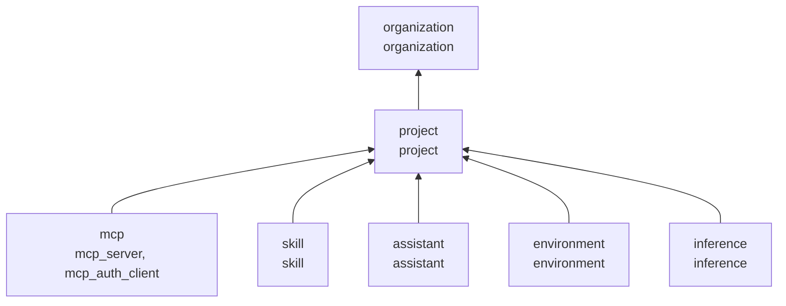
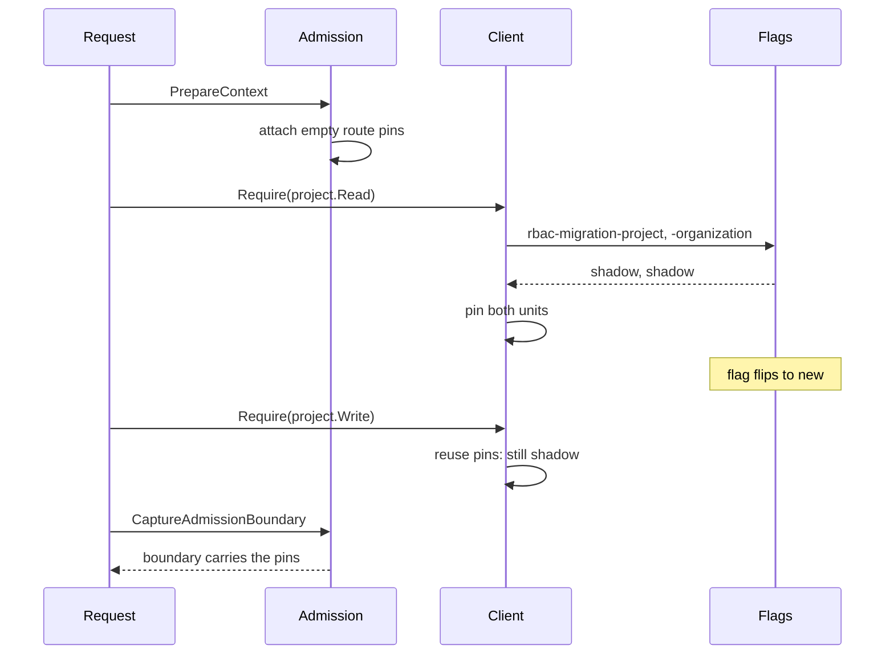
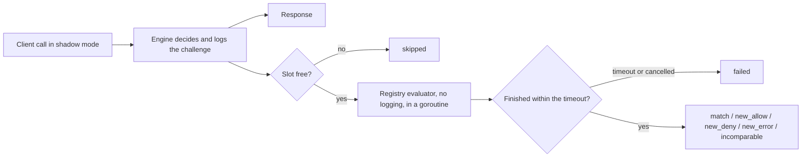

# Cutover routing and shadow comparison

The typed client (`authz.Client`) can answer a call with either evaluator: the engine (scope tables and selector matching, as today) or the registry evaluator (compiled declarations). This page explains how the client chooses, how a migration unit moves from one to the other, and what the shadow comparison records. It implements AIS-836 (RBAC F6) of the Backend Revamp milestone. The design decisions are in the [decision log](rbac-decision-log.md#f6-ais-836-cutover-routing-and-shadow-comparison).

## Migration units

A migration unit is a set of declared types whose operations switch evaluators together, plus the units its permissions depend on. Units are registered in `DefaultMigrationUnits()` (`server/internal/authz/migration_router.go`); `NewMigrationRouter` rejects undeclared types, a type in two units, unknown dependencies and cycles at startup.



Each unit has a mode: `old` (the engine decides), `shadow` (the engine decides and the registry evaluator is compared with it) or `new` (the registry evaluator decides). A call runs in one mode: the most conservative mode of every unit its operations touch, including the units those depend on. So `project` cannot run `new` while `organization` is `shadow`, and plugin publication (project or organization administration) never mixes evaluators. A type in no unit always runs `old`.

## Flags and defaults

Each unit is routed by its own multivariate PostHog flag, `rbac-migration-<unit>`, evaluated locally with the organization ID as the distinct ID (like `auth-client-resolver`, the flag must be person-aggregated and match `distinct_id` in a list of organization IDs).

| Variant         | Mode     | Who decides        |
| --------------- | -------- | ------------------ |
| none (flag off) | `old`    | engine             |
| `shadow`        | `shadow` | engine, compared   |
| `new`           | `new`    | registry evaluator |
| anything else   | `old`    | engine             |

The default is `old` for every unit: a flag that is off, unknown, unavailable or failing keeps the engine deciding. Merging a migration therefore changes no decision. The authorization platform owns these keys; a unit's flag is deleted once its engine path is removed (X1 to X4).

## Pinning



Admission (`GrantsToContext` and every admitted-policy path) attaches an empty set of route pins to the request. The first call that touches a unit reads its flag, and the flags of every unit it depends on, and pins them; every later call in the request reuses them. A refresh keeps the pins, and a captured admission boundary carries them into the job it admits. A flag flipped mid-request therefore never mixes evaluators within one request or job. A context that admission never prepared has no pins and runs `old`.

## Shadow comparison



The engine always answers first and its answer is the response; nothing in the comparison reaches the caller. The registry evaluator then answers the same call from the same prepared policies, captured boundary and facts, without recording a challenge or writing anything. It reads nothing new, so it adds no queries.

Outcomes:

| Outcome        | Meaning                                                                                          | Parity?  |
| -------------- | ------------------------------------------------------------------------------------------------ | -------- |
| `match`        | Same answer, or the same error category                                                          | yes      |
| `new_allow`    | The registry evaluator allows what the engine denied or could not decide                         | mismatch |
| `new_deny`     | The registry evaluator denies what the engine allowed                                            | mismatch |
| `new_error`    | The error category changed: the evaluator failed where the engine decided, or failed differently | mismatch |
| `incomparable` | The evaluator lacked facts equivalent to what the engine read                                    | no       |
| `skipped`      | The concurrency budget was exhausted; the evaluator did not run                                  | no       |
| `failed`       | The comparison timed out or the request was cancelled                                            | no       |

Each comparison is recorded through `ShadowRecorder`. The production recorder (`NewShadowRecorder`) logs disagreements at warn, inconclusive comparisons at info and matches at debug, and counts every comparison in `gram.authz.shadow.comparisons` with a `gram.authz.shadow.duration` histogram. Records carry the organization, units, entry point, permission names, outcome, a category detail, the build SHA and the model version (`Registry.Fingerprint()`). They never carry resource IDs, principals or grants.

### Budget

`DefaultShadowBudget` allows 64 concurrent comparisons and waits at most 50 ms for each. A comparison that times out keeps its slot until the evaluator finishes, so slow evaluations cannot pile up. These are safety limits, not activation thresholds: the counters (by outcome and detail) and the duration histogram are the inputs for agreeing the numbers a unit must meet before it moves to `new`.

## Rolling out a unit

1. The migration merges with the unit's flag off. Nothing changes.
2. Set `rbac-migration-<unit>` to `shadow` for internal organizations, then widen. Watch `gram.authz.shadow.comparisons` for `new_allow`, `new_deny` and `new_error`, and the `authz shadow disagreement` log line for the permission and category.
3. Resolve or explicitly accept every mismatch. An intended access change needs its own approval.
4. Once the agreed budgets and thresholds hold, set the flag to `new` for the same organizations, then widen.
5. To recover, set the flag back to `shadow` or off. New requests return to the engine, which reads the same tables; requests already in flight finish with the evaluator they pinned. New-authority errors always fail closed.

## Verifying

```bash
cd server
go test ./internal/authz -run 'TestShadowFoundationCorpus|TestShadowDetectsBrokenProjection|TestRoutesArePinnedPerAuthorizationBoundary|TestRouteTakesTheMostConservativeMode|TestShadowComparer|TestNewAuthorityErrorsFailClosed|TestOldModeMatchesTheEngine' -v
go test ./internal/feature -run TestRBACMigrationVariant
```

`TestShadowFoundationCorpus` runs every selected frozen fixture with all units in shadow mode: every response still meets its frozen expectation, and every comparison matches. `TestShadowDetectsBrokenProjection` compiles a registry that drops a read block and shows it caught as `new_allow` on `Require`, `Evaluate` and `MatchMany` while the engine keeps denying.
