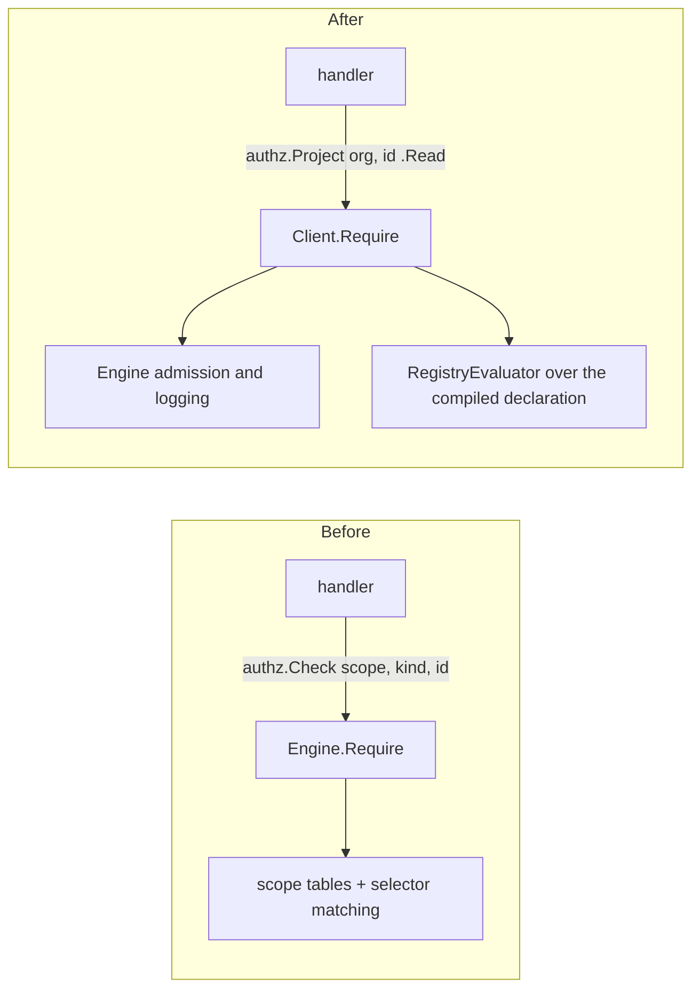

# Migrating a service to the typed authorization client

This is the recipe every Backend Revamp migration ticket follows (parent AIS-830). The [inventory](rbac-foundation-migration.md) says which ticket owns which consumer; the [decision log](rbac-decision-log.md) records every design call.

## What a migration changes

A handler stops assembling scope, resource kind and selector combinations, and names an operation instead. Admission, grant loading, challenge logging and error mapping do not change.

## Steps

1. **Declare the type.** Add the resource's `s.NewType(...)` to `DefaultDeclarations()` in `server/internal/authz/declarations.go`. Its `Grant`/`Block` relations name the existing stored scopes; each permission that answers an existing check carries `s.Checks(<scope>)`. `TestSchemaProjectionsMatchFrozenTables` must still pass: every compiled scope reproduces its frozen `scope_tables.golden` entry. Add the new scopes to the `declared` list in that test.
2. **Add typed constructors.** In `server/internal/authz/operation.go`, add a `<Resource>Ref` with one method per operation, built with `newOperation` or `newAlternatives`, and list one instance of each in `typedOperations()`. `NewClient` refuses to start if any is undeclared. Use the RFC's operation names; replace an ad-hoc `RequireAny` with a declared `s.Alternatives`.
3. **Inject the client.** Pass the `*authz.Client` built in `server/cmd/gram/start.go` (and any other command that constructs the service) to the service constructor. Tests use `authztest.NewClient(t, engine)`.
4. **Switch the calls.** Replace each `authz.Check` the service builds with the typed operation, and `Require`/`Evaluate`/`FindMatched` with the client's `Require`/`Evaluate`/`MatchMany`. Keep the handler's existing error remapping (for example forbidden to not found). Load facts before asking for a fact-reading permission and attach them with `WithFacts`.
5. **Refresh the inventory.** Run `go test ./internal/authz -run TestFoundationInventory -update-foundation-inventory`. The service's rows leave `consumers.csv`; nothing else should change.
6. **Prove parity.** `TestClientFoundationCorpus` picks up every frozen fixture the new type answers; raise its expected count after checking each new case runs. Add fixtures for operations the corpus does not cover yet. Run the service's own tests. Where the change touches the dashboard or MCP connections, run the RBAC end-to-end suite (`mise run test:rbac-e2e`) and attach the result.
7. **Record decisions.** Add a section for the ticket to `docs/rbac-decision-log.md`, and list the same items under "Decisions made without reviewer input" in the PR body.

## Conventions for parallel work

- Branch per ticket, stacked on the client branch or on the ticket it depends on. Label PRs `rbac-migration`.
- Code comments describe lasting purpose only: never ticket ids, milestones or work keys. Docs, PR bodies and the inventory may name tickets.
- Write "Speakeasy" in new user-facing text.
- Never change a frozen fixture expectation in a migration; a changed expectation is an access change and needs its own approval.
- Each ticket appends its own section to the decision log and its own block to `DefaultDeclarations()` and `typedOperations()`, so sibling branches conflict only at those append points.
