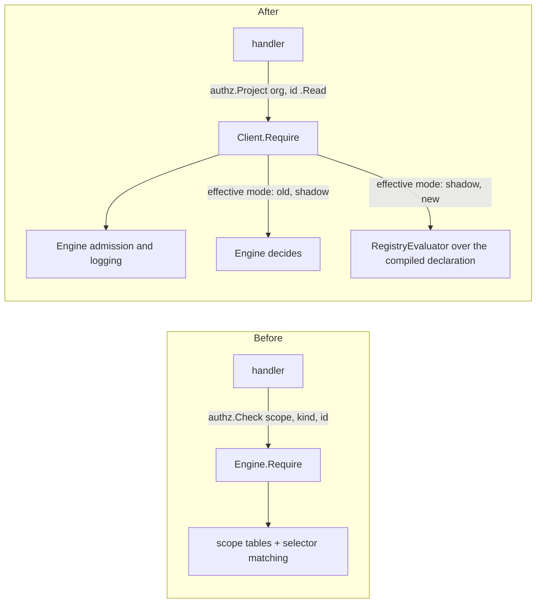

# Migrating a service to the typed authorization client

This is the recipe every Backend Revamp migration ticket follows (parent AIS-830). The [inventory](rbac-foundation-migration.md) says which ticket owns which consumer; the [decision log](rbac-decision-log.md) records every design call.

## What a migration changes

A handler stops assembling scope, resource kind and selector combinations, and names an operation instead. Admission, grant loading, challenge logging and error mapping do not change. Which evaluator decides is chosen per migration unit by a feature flag, and every unit starts with the engine deciding; see [cutover routing and shadow comparison](rbac-cutover-routing.md).

## Steps

1. **Declare the type.** Write the resource's `s.NewType(...)` as its own `<type>Type()` function in `server/internal/authz/declarations.go`, and add a call to it in `DefaultDeclarations()`. Grants and blocks are named by their existing stored scope constants (`s.Block(ScopeXBlockedRead, s.BlockSpec{...})`) and grant nothing themselves. Most permissions are "this scope, the scopes that imply it, and its block": declare those with one `s.ScopePermission("read", ScopeXRead, s.GrantSpec{...}, s.AlsoGrantedBy(ScopeXWrite), s.ExcludedBy(ScopeXBlockedRead))`, which declares the grant and a permission that answers its scope. Use `s.Grant` plus `s.Permission` only for any other expression, such as a `Minus` or an attribute rule, and give such a permission `s.AnswersScope(<scope>)` when it answers an existing check. A block that a broader block also imposes lists it in `ImpliedBy: s.Scopes(...)`, and a permission that a block protects names only its direct block with `s.ExcludedBy`; a permission no block applies to has no `s.ExcludedBy`. and every `s.Alternatives` sets `Blocks` to `s.AnyBlockVetoes` or `s.BlocksApplyPerOption`. `TestSchemaProjectionsMatchFrozenTables` must still pass: every compiled scope reproduces its frozen `scope_tables.golden` entry. Add the new scopes to the `declared` list in that test.
2. **Register the unit.** Add the new types to a `MigrationUnit` in `DefaultMigrationUnits()` (`server/internal/authz/migration_router.go`), with `DependsOn` naming every unit its permissions traverse or offer as alternatives. The unit's flag is `rbac-migration-<unit>`.
3. **Add typed constructors.** In `server/internal/authz/operation.go`, add a `<Resource>Ref` with one method per operation, built with `newOperation` or `newAlternatives`, and list one instance of each in `typedOperations()`. `NewClient` refuses to start if any is undeclared. Use the RFC's operation names; replace an ad-hoc `RequireAny` with a declared `s.Alternatives`.
4. **Inject the client.** Pass the `*authz.Client` built in `server/cmd/gram/start.go` (and any other command that constructs the service) to the service constructor. Tests use `authztest.NewClient(t, engine)`, where the engine decides as in production with the flag off, and `authztest.NewClientInMode(t, engine, mode)` to run the same tests in shadow and new mode.
5. **Switch the calls.** Replace each `authz.Check` the service builds with the typed operation, and `Require`/`Evaluate`/`FindMatched` with the client's `Require`/`Evaluate`/`MatchMany`. Replace `EvaluateLoadedGrants` with `EvaluateLoaded` and use `RequireLoaded` for policies the service loaded itself; `GrantsAuthorize` on one grant set becomes `EvaluateGrants`. Keep the handler's existing error remapping (for example forbidden to not found). Load facts before asking for a fact-reading permission and attach them with `WithFacts`.
6. **Refresh the inventory.** Run `cd server && go test ./internal/authz -run TestFoundationInventory -update-foundation-inventory`. The service's rows leave `consumers.csv`; nothing else should change.
7. **Prove parity.** `TestClientFoundationCorpus` picks up every frozen fixture the new type answers; raise its expected count after checking each new case runs. Add fixtures for operations the corpus does not cover yet. Run the service's own tests. `TestShadowFoundationCorpus` must still report no disagreement. Where the change touches the dashboard or MCP connections, attach end-to-end evidence from the dashboard Playwright workflow (`mise run playwright`, see the `gram-playwright-cli` skill) for the affected pages and connections. A dedicated RBAC end-to-end suite is being built separately; use it once it lands.
8. **Record decisions.** Add a section for the ticket to `docs/rbac-decision-log.md`, and list the same items under "Decisions made without reviewer input" in the PR body.

A merged migration changes no decision: its unit's flag is off, so the engine still decides. The [rollout](rbac-cutover-routing.md#rolling-out-a-unit) moves the unit to shadow, then to new, per organization.

## Conventions for parallel work

- Branch per ticket, stacked on the client branch or on the ticket it depends on. Label PRs `rbac-migration`.
- Keep each type in its own `<type>Type()` function and add one call to `DefaultDeclarations()`, so stacked migrations touch separate functions instead of one shared list of declarations.
- Code comments describe lasting purpose only: never ticket ids, milestones or work keys. Docs, PR bodies and the inventory may name tickets.
- Write "Speakeasy" in new user-facing text.
- Never change a frozen fixture expectation in a migration; a changed expectation is an access change and needs its own approval.
- Each ticket appends its own section to the decision log and its own block to `DefaultDeclarations()`, `typedOperations()` and `DefaultMigrationUnits()`, so sibling branches conflict only at those append points.
