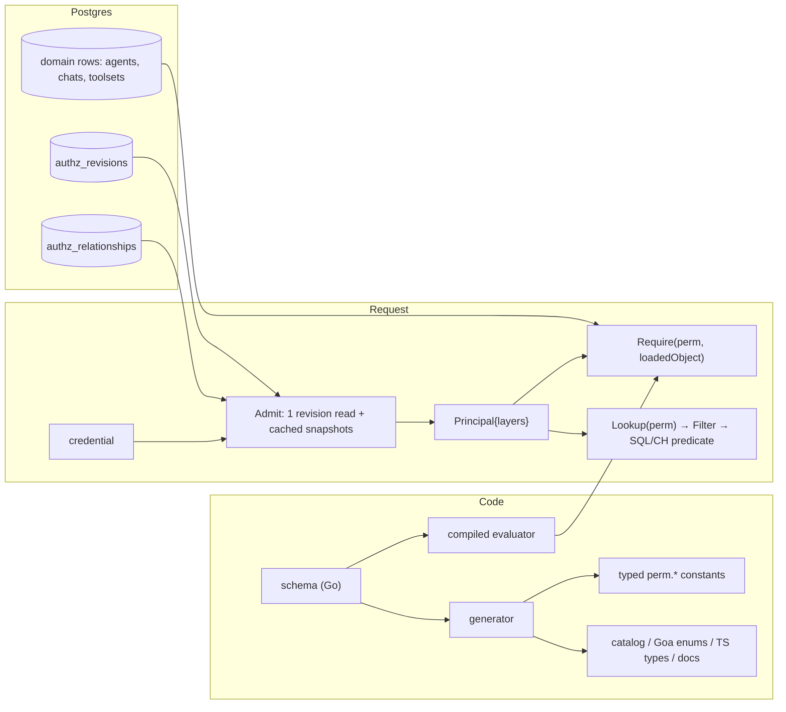

# Clean-slate authorization: proposed design

This is the direction checkpoint. It builds on the approved requirements
baseline ([review `pn-3a184d`](clean-slate-authz-requirements-review.md)) and
proposes a complete model with code sketches. It also compares the model with
adopting OpenFGA. You asked for few iterations, so this draft resolves the open
questions from the baseline with labeled **recommendations** instead of asking
about them one at a time. Overturn any of them in a comment.

All code below is illustrative proposed code. None of it exists in the
repository.

## Summary

We propose a Zanzibar-style relationship model, stored in our own Postgres and
evaluated by our own Go engine. It has four parts.

1. **One schema, written in Go.** It declares object types, the relations that
   can be granted on them, and permissions computed from those relations
   (union, exclusion, intersection, and traversal to parents). Everything else
   is generated from it: the permission catalog, typed handler constants, Goa
   enums, dashboard types and docs.
2. **One relationship table.** Every grant, role assignment, group membership
   and audience entry is a row of the form `object#relation@subject`. Each row
   can have an optional condition (such as a tool filter) and an optional
   expiry. Relationships are written in the same transaction as the domain
   change that caused them.
3. **Subject-side snapshots.** At admission, we load every relationship whose
   subject is the caller, or a set the caller belongs to, in one query. The
   snapshot can be cached, keyed by a per-organization revision (section 3 covers cache safety). A check is then a
   few map lookups that use the resource the handler has already loaded. A
   check never does I/O.
4. **Four questions, one engine.** `Require` or `Check` (may I?), `Lookup`
   (which ones, as a SQL or ClickHouse predicate), `CanGrant` (may I
   delegate?) and `Explain` (why?) all use the same compiled schema. The
   dashboard asks the server instead of re-implementing the rules.

The main disadvantage is that we own the evaluator and its correctness. We
reduce that risk by limiting the schema to operators OpenFGA also supports, and
by using OpenFGA as a differential test oracle in CI rather than as a
production dependency.



## 1. The schema

### Object types and relations

A **type** is something we protect, such as `organization`, `project`,
`mcp_server`, `agent`, `chat` or `user`. A type has three kinds of member:

- **Grantable relations.** These are stored as relationships. A grant can be
  _anchored_ at the object itself or at any of its ancestors. A grant of
  `mcp_server.connector` on project P covers every server in P. That replaces
  today's `resource_id: "*"` plus `project_id` selectors.
- **Attributes.** These are relations read from the domain row the handler
  already loaded, such as `agent.owner` (from `agents.owner_user_id`) and
  `chat.author`. Ownership stays where it already lives, so there is nothing to
  keep in sync.
- **Permissions.** These are expressions over relations, attributes and parent
  permissions. Handlers check permissions, never relations.

```go
package schema

var MCPServer = s.Type("mcp_server",
	s.Parent(Project),

	s.Grant("editor", s.AnchoredAt(Organization, Project, s.Self),
		s.Describe("Edit configuration, connection audience and visibility")),
	s.Grant("viewer", s.AnchoredAt(Organization, Project, s.Self),
		s.Describe("Inspect non-secret configuration")),
	s.Grant("connector", s.AnchoredAt(Organization, Project, s.Self),
		s.Conditions(cond.MCPTools), // optional tool / disposition filter
		s.Delegable(),               // may appear in an agent policy
		s.Describe("Connect to the server and call its tools")),
	s.Block("connect_blocked", s.AnchoredAt(Organization, Project, s.Self),
		s.Conditions(cond.MCPTools)),

	s.Permission("edit", s.Rel("editor")),
	s.Permission("read", s.Union(s.Rel("viewer"), s.Perm("edit"))),
	// No edge from edit or read: managing a server never grants use.
	s.Permission("connect", s.Rel("connector"), s.ExcludedBy("connect_blocked")),
)
```

`s.Rel("connector")` walks the anchors automatically. It matches a
relationship on the server, on its project, or on the organization. Each type
declares its parents, which are always the fixed chain organization → project →
resource. That lets the engine resolve ancestors from the loaded object rather
than by traversing a graph.

### Sensitive access and activity review

The activity requirements fit the same operators. A reviewer is granted
`activity_reviewer` anchored at a group (a team), or at the organization. A
protected employee carries a `protected` marker that removes ordinary
reviewers. Only an explicit `protected_reviewer` can see their activity, and
that grant is typically temporary.

```go
var User = s.Type("user", // the human whose activity is recorded
	s.Parent(Organization),
	s.Member(Group), // group:G#member@user:U, maintained by directory sync

	s.Grant("activity_reviewer", s.AnchoredAt(Organization, Group), s.Sensitive(),
		s.Describe("Read transcripts of this person's sessions")),
	s.Grant("protected_reviewer", s.AnchoredAt(Organization), s.Sensitive()),
	s.Marker("protected", s.Describe("Hide activity from ordinary reviewers")),

	s.Permission("review_activity", s.Union(
		s.Minus(s.Rel("activity_reviewer"), s.Marked("protected")),
		s.Rel("protected_reviewer"),
	)),
)

var Chat = s.Type("chat",
	s.Parent(Project),
	s.Attr("author", User), // chats.user_id
	s.Attr("agent", Agent), // chats.agent_id

	s.Permission("read", s.Union(
		s.Is("author"),                     // personal history stays with the user
		s.Via("agent", "manage"),           // the agent's current owner
		s.Via("author", "review_activity"), // team or org review, aware of protection
		s.Via("agent", "review_activity"),  // review of the owner's team
	)),
	s.Permission("delete", s.Union(s.Is("author"), s.Via("project", "chat_admin"))),
)

var Agent = s.Type("agent",
	s.Parent(Project),
	s.Attr("owner", User), // agents.owner_user_id

	s.Grant("manager", s.AnchoredAt(Organization, Project, s.Self)),
	s.Grant("viewer", s.AnchoredAt(Organization, Project, s.Self)),

	s.Permission("manage", s.Union(s.Is("owner"), s.Rel("manager"))),
	s.Permission("read", s.Union(s.Perm("manage"), s.Rel("viewer"))),
	s.Permission("review_activity", s.Via("owner", "review_activity")),
)

var Organization = s.Type("organization",
	s.Grant("agent_creator", s.AnchoredAt(s.Self), s.Describe("Create agents you own")),
	s.Grant("access_admin", s.AnchoredAt(s.Self), s.Describe("Manage roles, grants and protection")),
	s.Permission("create_agent", s.Rel("agent_creator")),
	s.Permission("manage_access", s.Rel("access_admin")),
)
```

### Subjects, roles and groups

A relationship's subject is either a single principal or a **subject set**.

| Subject                          | Meaning                                                                    |
| -------------------------------- | -------------------------------------------------------------------------- |
| `user:U`, `agent:A`, `api_key:K` | One principal.                                                             |
| `role:R#assignee`                | Everyone assigned role R. This includes the system roles admin and member. |
| `group:G#member`                 | Everyone in directory group G.                                             |
| `organization:O#member`          | Every active member. This replaces `user:all`.                             |

A custom role is a type with one relation, `assignee`. Assigning someone a role
is itself a relationship, `role:R#assignee@user:U`, so it can have an expiry
like any other relationship. Directory group-to-role mappings become
`role:R#assignee@group:G#member`. Attribute-based directory rules are
materialized by directory sync into synthetic groups.

### Conditions

Today's selector dimensions become typed conditions on a relationship, in the
style of SpiceDB caveats or OpenFGA conditions.

```go
package cond

// MCPTools restricts a connector grant to named tools and/or dispositions.
var MCPTools = s.Condition[MCPToolsParams, MCPToolContext]("mcp_tools",
	func(p MCPToolsParams, c MCPToolContext) s.Tri {
		if c.Tool == "" && c.Disposition == "" {
			return s.Unknown // fact not supplied
		}
		return s.Bool(p.matches(c.Tool, c.Disposition))
	})

type MCPToolsParams struct {
	Tools        []string `json:"tools,omitempty"`
	Dispositions []string `json:"dispositions,omitempty"`
}

type MCPToolContext struct {
	Tool        string
	Disposition string
}
```

Conditions return a three-valued result. `Unknown` on an allow makes that
allow unusable. `Unknown` on a block blocks, so the check fails closed. This
replaces today's permissive matching, which skips missing dimensions, with an
explicit question. "Can this caller connect at all?" is asked as
`Eligible(perm.MCPServerConnect, srv)`. That asks whether any context could
satisfy the condition, rather than reusing a concrete check without its facts.

### Workflows

The schema can also declare which permissions a workflow needs. The catalog
and role editor read these declarations to answer "what does someone need to
operate an MCP server?" without anyone working it out by hand.

```go
var OperateMCPServer = s.Workflow("Operate an MCP server",
	s.Needs(MCPServer, "edit"), s.Needs(Environment, "write"))
```

## 2. Storage

```sql
CREATE TABLE IF NOT EXISTS authz_relationships (
  id uuid NOT NULL DEFAULT generate_uuidv7(),
  organization_id TEXT NOT NULL,

  object_type TEXT NOT NULL,          -- 'mcp_server', 'project', 'role', ...
  object_id TEXT NOT NULL,            -- always concrete; breadth comes from the anchor
  relation TEXT NOT NULL,             -- 'connector', 'mcp_server.connector' when anchored above, 'assignee'
  subject_type TEXT NOT NULL,         -- 'user', 'agent', 'api_key', 'role', 'group', 'organization'
  subject_id TEXT NOT NULL,
  subject_relation TEXT NOT NULL DEFAULT '',  -- '' for a principal, 'assignee'/'member' for a set

  condition_name TEXT,
  condition_params JSONB,
  expires_at timestamptz,             -- NULL means no expiry; evaluated at check time

  source TEXT NOT NULL,               -- admin | provisioned | directory_sync | self_service | temporary_access
  source_ref TEXT,                    -- e.g. the access request id
  created_by TEXT,
  created_at timestamptz NOT NULL DEFAULT clock_timestamp(),

  CONSTRAINT authz_relationships_pkey PRIMARY KEY (id),
  CONSTRAINT authz_relationships_org_fkey FOREIGN KEY (organization_id)
    REFERENCES organization_metadata (id) ON DELETE CASCADE,
  CONSTRAINT authz_relationships_condition_check
    CHECK ((condition_name IS NULL) = (condition_params IS NULL))
);

-- Admission: every relationship where the caller, or a set the caller is in, is the subject.
CREATE INDEX IF NOT EXISTS authz_relationships_subject_idx
ON authz_relationships (organization_id, subject_type, subject_id, subject_relation);

-- Audiences, "who has access", Explain, and cascade deletes.
CREATE UNIQUE INDEX IF NOT EXISTS authz_relationships_object_key
ON authz_relationships (organization_id, object_type, object_id, relation,
                        subject_type, subject_id, subject_relation,
                        COALESCE(condition_name, ''), COALESCE(condition_params, 'null'::jsonb));

-- One monotonically increasing revision per organization, bumped by a trigger
-- in the same transaction as any relationship write.
CREATE TABLE IF NOT EXISTS authz_revisions (
  organization_id TEXT NOT NULL PRIMARY KEY,
  revision BIGINT NOT NULL DEFAULT 0
);

-- The workflow for temporary sensitive access. Activation writes a relationship
-- with source = 'temporary_access', source_ref = request id, and expires_at set.
CREATE TABLE IF NOT EXISTS authz_access_requests (
  id uuid NOT NULL DEFAULT generate_uuidv7() PRIMARY KEY,
  organization_id TEXT NOT NULL,
  requester_user_id TEXT NOT NULL,
  object_type TEXT NOT NULL,
  object_id TEXT NOT NULL,
  relation TEXT NOT NULL,
  reason TEXT NOT NULL,
  max_duration interval NOT NULL,
  status TEXT NOT NULL,               -- requested | approved | declined | active | ended
  decided_by TEXT,
  decided_at timestamptz,
  activated_at timestamptz,
  ends_at timestamptz,
  relationship_id uuid
);
```

**Revocation stays strongly consistent.** A relationship and the domain row
that caused it are written in one Postgres transaction. The trigger bumps the
revision in that same transaction. The next request reads the new revision and
rebuilds its snapshot.

**Expiry needs no cleanup to take effect.** Expiry is part of evaluation: every
relationship is ignored once `now() >= expires_at`, and a snapshot carries
`ValidUntil = min(expires_at)` so it rebuilds itself. A sweeper deletes expired
rows later, for tidiness only.

Blocks are relations of their own, such as `connect_blocked`. Allow and deny
are never a column flag that the evaluator could forget to read.

### Example data

The rest of this document uses one small organization, `org_acme`, with one
project, `proj_web`, and one MCP server, `srv_linear`.

| Person or credential | Situation                                                                   |
| -------------------- | --------------------------------------------------------------------------- |
| Alice                | Engineering lead. Reviews her team's activity. Owns the agent `agt_triage`. |
| Bob                  | Engineer on Alice's team.                                                   |
| Carol                | Executive. Marked as protected.                                             |
| Dave                 | Platform operator. May edit servers in `proj_web` but not use them.         |
| Erin                 | Investigator. Has temporary access to protected activity until 15:30.       |
| `key_123`            | The API key `agt_triage` authenticates with. It is limited to `srv_linear`. |

These are the rows in `authz_relationships`. Only the essential columns are
shown, and `cond` means `condition_name` plus `condition_params`.

| #   | object                  | relation                  | subject                        | cond / expires                                           | source                      |
| --- | ----------------------- | ------------------------- | ------------------------------ | -------------------------------------------------------- | --------------------------- |
| 1   | `organization:org_acme` | `member`                  | `user:alice`                   |                                                          | directory_sync              |
| 2   | `organization:org_acme` | `member`                  | `user:bob`                     |                                                          | directory_sync              |
| 3   | `organization:org_acme` | `member`                  | `user:carol`                   |                                                          | directory_sync              |
| 4   | `role:role_member`      | `assignee`                | `organization:org_acme#member` |                                                          | provisioned                 |
| 5   | `group:grp_eng`         | `member`                  | `user:alice`                   |                                                          | directory_sync              |
| 6   | `group:grp_eng`         | `member`                  | `user:bob`                     |                                                          | directory_sync              |
| 7   | `role:role_eng`         | `assignee`                | `group:grp_eng#member`         |                                                          | admin                       |
| 8   | `organization:org_acme` | `agent_creator`           | `role:role_member#assignee`    |                                                          | provisioned                 |
| 9   | `project:proj_web`      | `mcp_server.viewer`       | `role:role_member#assignee`    |                                                          | provisioned                 |
| 10  | `mcp_server:srv_linear` | `connector`               | `role:role_eng#assignee`       |                                                          | admin                       |
| 11  | `mcp_server:srv_linear` | `connect_blocked`         | `role:role_eng#assignee`       | `mcp_tools {dispositions:[destructive]}`                 | admin                       |
| 12  | `project:proj_web`      | `mcp_server.editor`       | `user:dave`                    |                                                          | admin                       |
| 13  | `group:grp_eng`         | `user.activity_reviewer`  | `user:alice`                   |                                                          | admin                       |
| 14  | `user:carol`            | `protected`               | `organization:org_acme`        |                                                          | admin                       |
| 15  | `organization:org_acme` | `user.protected_reviewer` | `user:erin`                    | expires 2026-10-27 15:30Z                                | temporary_access (`req_77`) |
| 16  | `mcp_server:srv_linear` | `connector`               | `agent:agt_triage`             | `mcp_tools {tools:[list_issues,get_issue,update_issue]}` | self_service                |
| 17  | `mcp_server:srv_linear` | `connector`               | `api_key:key_123`              |                                                          | self_service                |

A few rows show how the new requirements look as data:

- **Row 12 separates management from use.** Dave can edit every server in
  `proj_web`, but no row makes him a `connector`, so he cannot connect.
- **Row 14 is the protection marker.** Every row reads "object has relation
  to subject". The object is whatever the fact is _about_, and here the fact
  is about Carol: her activity is what is being protected. The row reads
  "user `carol` is `protected`, as declared by organization `org_acme`."
  - **The `user` type has two roles.** When Carol signs in, `user:carol` is a
    _subject_, someone who receives grants. In row 14 she is the _object_,
    the person whose sessions a reviewer wants to read. Row 13 has the same
    shape: it puts a grant on group `grp_eng`, the team being reviewed, not
    on the reviewer.
  - **The subject only records scope.** It says which organization set the
    marker. `Marked("protected")` is a flag: the engine only asks whether such
    a row exists for the target, and never matches the caller against the
    subject.
  - **OpenFGA would write the row differently.** There, a relation must be
    evaluated against the caller, so the same fact is written
    `user:carol#protected@user:*` ("protected from every user") and used with
    `but not protected`.
- **Row 15 is temporary access.** It stops counting at 15:30 even if nothing
  deletes it.
- **Row 16 is Alice's self-service delegation.** `CanGrant` accepted it
  because Alice holds `connector` on `srv_linear`, through rows 5, 7 and 10.

`authz_revisions` holds a single row for the organization:

| organization_id | revision |
| --------------- | -------- |
| `org_acme`      | 4812     |

The domain tables still own their facts. `agents` stores
`agt_triage.owner_user_id = alice` and `status = active`, and `chats` stores
`author` and `agent_id` for each session. These are read from the loaded row,
never copied into `authz_relationships`.

## 3. The engine

### Core types

```go
package authz

// Subject is a principal or a subject set (role:R#assignee).
type Subject struct {
	Type     string
	ID       string
	Relation string
}

// Ref identifies a protected object, plus the facts needed to evaluate it
// without I/O. Generated per type, so handlers never build one by hand.
type Ref struct {
	Type    schema.TypeName
	ID      string
	Parents []Ref                         // nearest first; the organization is always last
	Attrs   map[schema.AttrName][]Subject // owner, author, agent: read from the loaded row
}

type Object interface{ AuthzRef() Ref }

// Permission is bound to its object type at compile time, so
// perm.MCPServerConnect cannot be checked against a project.
type Permission[T Object] struct{ id schema.PermissionID }

type Outcome uint8

const (
	Denied Outcome = iota
	Allowed
	Undetermined // a needed fact was missing; treated as denied, with diagnostics
)

type Decision struct {
	Outcome Outcome
	Missing []string // facts the schema needed but the call did not supply
	Layer   LayerKind // the first layer that refused, when not Allowed
	Perm    schema.PermissionID
	Path    []Step   // filled in by Explain: user → role → grant on project → server
}
```

### The principal and its layers

A **layer** is one independent set of permissions that must say yes. Most
requests have a single layer: the signed-in person. Requests made on someone
else's behalf have several, and an operation is allowed only when every layer
allows it.

| Caller                              | Layers                                                                          | Why each layer exists                                                                                                                                                                       |
| ----------------------------------- | ------------------------------------------------------------------------------- | ------------------------------------------------------------------------------------------------------------------------------------------------------------------------------------------- |
| Alice in the dashboard              | `user:alice`                                                                    | Only her own permissions apply.                                                                                                                                                             |
| `agt_triage` using `key_123`        | `api_key:key_123` (ceiling), `agent:agt_triage` (subject), `user:alice` (owner) | The key was issued for one server only. The agent has its own policy. The owner's current permissions bound what her agent can do, so removing Alice from Engineering also stops her agent. |
| A workload session for `agt_triage` | session ceiling, agent, owner                                                   | The same as above, except the ceiling is the approved session policy.                                                                                                                       |
| A derived credential acting for Bob | ceiling, agent, owner, `user:bob` (authorizer)                                  | The person who authorized it must still hold the access.                                                                                                                                    |

We could instead merge the layers into one permission set when the request is
admitted. Intersecting sets that contain wildcards, project anchors and
conditions is error-prone, though, and a single merged set cannot tell you
which layer refused an operation. Evaluating each layer separately keeps every
layer simple, gives accurate denial reasons ("the owner lacks access"), and
matches what `grantAuthorization.evaluate` already does today.

The principal produced at admission holds one snapshot per layer.

```go
type Principal struct {
	Actor      Subject   // user:U, agent:A or api_key:K
	Represents *Subject  // the represented user, bound from trusted context
	Layers     []*Snapshot
	Revision   int64
	ValidUntil time.Time // the earliest expiry across all layers
}

type LayerKind uint8

const (
	LayerSubject   LayerKind = iota // the actor's own relationships
	LayerOwner                      // the agent's current owner
	LayerAuthorizer                 // the human who authorized a derived credential
	LayerCeiling                    // a stored credential or session ceiling
)

// Snapshot is immutable after construction and safe to share between requests.
type Snapshot struct {
	Kind       LayerKind
	Subject    Subject
	byAnchor   map[anchorKey][]entry   // (objectType, objectID, relation) → entries
	byRelation map[schema.RelID][]entry // for Lookup: every anchor holding a relation
	validUntil time.Time
}

type entry struct {
	id        uuid.UUID // relationship id, for Explain and audit
	cond      *schema.BoundCondition
	expiresAt time.Time
	via       Subject // which subject set matched, e.g. role:R#assignee
}

// OrgFacts holds the object-side facts that some permissions read about the
// *target*, such as which groups Bob belongs to and whether he is protected.
// There is one per organization and revision, shared by every caller.
type OrgFacts struct {
	revision     int64
	groupsOf     map[string][]string // user id → group ids        (group#member rows)
	membersOf    map[string][]string // group id → user ids        (for Lookup expansion)
	markers      map[markerKey]bool  // (type, id, marker) → set    (e.g. user:carol#protected)
}
```

### What a snapshot looks like

A snapshot is the caller's grants, resolved and indexed. It is the closest
equivalent of today's `GrantsFromContext`, with four differences:

- **Memberships are already resolved.** It holds every row whose subject is
  the caller or a set the caller belongs to: their roles, their groups, and
  organization membership.
- **It is indexed.** Rows are keyed by `(object type, object id, relation)`,
  so a check makes a few map lookups instead of scanning a grant list.
- **Each entry records its origin.** The `via` field records which role or
  group the entry came from, which is what `Explain` reports. Each entry also
  keeps its condition and expiry.
- **There is one snapshot per layer.** An agent request carries three.

A snapshot holds nothing about the objects being checked. Ownership,
authorship and parents come from the loaded row, through `objects`. Target
facts such as group membership and protection come from `OrgFacts`.

Here is Alice's snapshot, built from the example data.

```text
Alice's subject closure (the sets she belongs to):
  user:alice
  organization:org_acme#member      ← row 1
  group:grp_eng#member              ← row 5
  role:role_member#assignee         ← row 4 (via organization member)
  role:role_eng#assignee            ← row 7 (via group member)

Snapshot{Kind: LayerSubject, Subject: user:alice, validUntil: +∞}
  byAnchor:
    (organization, org_acme, agent_creator)       → [row 8  via role:role_member#assignee]
    (project,      proj_web, mcp_server.viewer)   → [row 9  via role:role_member#assignee]
    (mcp_server,   srv_linear, connector)         → [row 10 via role:role_eng#assignee]
    (mcp_server,   srv_linear, connect_blocked)   → [row 11 via role:role_eng#assignee, cond mcp_tools{destructive}]
    (group,        grp_eng,  user.activity_reviewer) → [row 13 direct]
```

Dave's snapshot has one entry that matters,
`(project, proj_web, mcp_server.editor)`, and no `connector` entry, so Dave
can edit servers but not use them. Erin's snapshot has
`(organization, org_acme, user.protected_reviewer)` with
`expiresAt = 15:30Z`, so her snapshot's `validUntil` is 15:30Z.

A check walks from the object to its anchors and looks up each one:

```go
// Can Alice connect to srv_linear and call update_issue (disposition idempotent)?
// perm connect = Rel(connector) minus Rel(connect_blocked)
// anchors walked: mcp_server:srv_linear → project:proj_web → organization:org_acme

allow := snap.match("mcp_server", "srv_linear", "connector", ctx)            // row 10 → true
    || snap.match("project", "proj_web", "mcp_server.connector", ctx)       // none
    || snap.match("organization", "org_acme", "mcp_server.connector", ctx)  // none
block := snap.match("mcp_server", "srv_linear", "connect_blocked", ctx)      // row 11: cond says destructive? false
    || /* project and organization anchors: none */ false
// allow && !block → Allowed. Six map lookups, no I/O.
```

"Can Alice read Bob's chat?" uses `OrgFacts` for the facts about Bob:

```go
// chat.read includes Via("author", "review_activity"), and the author is user:bob.
// user.review_activity = Minus(Rel(activity_reviewer), Marked(protected)) + Rel(protected_reviewer)
groups := facts.groupsOf["bob"]                                            // [grp_eng]
reviewer := snap.match("group", "grp_eng", "user.activity_reviewer", nil)  // row 13 → true
protected := facts.markers[{"user", "bob", "protected"}]                   // false
// → Allowed. The same check for Carol's chat: Carol is in no group Alice reviews,
//   and she is protected (row 14) → Denied.
```

### The interface handlers see

```go
type Authorizer interface {
	// Check answers one question about one object. Zero I/O.
	Check(ctx context.Context, req Request) (Decision, error)
	CheckBatch(ctx context.Context, reqs []Request) ([]Decision, error)

	// Eligible asks whether any context would satisfy the permission,
	// for example connection admission before the tool is known.
	Eligible(ctx context.Context, req Request) (Decision, error)

	// Lookup returns a predicate for list queries, not a list of IDs.
	Lookup(ctx context.Context, perm schema.PermissionID, within Ref) (Filter, error)

	// CanGrant checks delegation containment before relationships are written.
	CanGrant(ctx context.Context, to Subject, proposed []Relationship) error

	// Explain is Check with a populated Path, for "why do I have access".
	Explain(ctx context.Context, subject Subject, req Request) (Decision, error)
}

type Request struct {
	Perm    schema.PermissionID
	Object  Ref
	Context schema.ConditionContext // e.g. cond.MCPToolContext
}

// Typed helpers are thin generic wrappers, so call sites stay one line.
func Require[T Object](ctx context.Context, a Authorizer, p Permission[T], obj T, opts ...Opt) error
func Can[T Object](ctx context.Context, a Authorizer, p Permission[T], obj T, opts ...Opt) bool
func Eligible[T Object](ctx context.Context, a Authorizer, p Permission[T], obj T) bool
func List[T Object](ctx context.Context, a Authorizer, p Permission[T], within Ref) (Filter, error)
```

`Require` maps `Denied` and `Undetermined` to `oops.CodeForbidden`. It logs the
missing facts and records the decision for telemetry and for the
handler-coverage check described below.

### Admission and caching

```go
type Admitter interface {
	// Admit runs once per request in the auth middleware. Cache hit: one
	// primary-key read of authz_revisions. Cache miss: one query per layer.
	Admit(ctx context.Context, cred Credential) (*Principal, error)
}

type SnapshotCache interface {
	Get(org string, s Subject, kind LayerKind, revision int64) (*Snapshot, bool)
	Put(org string, s Subject, kind LayerKind, revision int64, snap *Snapshot)
}
```

The snapshot loader is one recursive query. It starts from the caller's
principal and from `organization:O#member`. It follows membership relations
(`assignee`, `member`) to a bounded depth, then returns every unexpired
relationship whose subject is in that closure.

```sql
-- name: LoadSubjectRelationships :many
WITH RECURSIVE closure(subject_type, subject_id, subject_relation, depth) AS (
  SELECT @subject_type::text, @subject_id::text, ''::text, 0
  UNION ALL SELECT 'organization', @organization_id::text, 'member', 0 WHERE @is_member::bool
  UNION
  SELECT r.object_type, r.object_id, r.relation, c.depth + 1
  FROM authz_relationships r
  JOIN closure c USING (subject_type, subject_id, subject_relation)
  WHERE r.organization_id = @organization_id
    AND r.relation IN ('assignee', 'member')
    AND (r.expires_at IS NULL OR r.expires_at > clock_timestamp())
    AND c.depth < 3
)
SELECT r.*
FROM authz_relationships r
JOIN closure c USING (subject_type, subject_id, subject_relation)
WHERE r.organization_id = @organization_id
  AND (r.expires_at IS NULL OR r.expires_at > clock_timestamp());
```

On a cache hit, admission costs one primary-key read. A cached snapshot is
reused only when its revision matches the current one, so revocation is still
seen on the very next request. For agent requests, the agent, owner and ceiling
layers are cached separately and checked against the same revision.

### Cache safety

Caching authorization data is where a design like this usually goes wrong. The
risk is that a revoked grant keeps working because some cache did not hear
about the revocation. Our design avoids that by never _invalidating_ the cache.
Instead, each request validates what it uses: the cache is a memo of a
deterministic function, `snapshot(org, subject, layer, revision, schemaHash)`.
A missing, evicted or wrong-sized cache entry makes a request slower, never
more permissive.

The cache is correct only if each of these invariants holds:

1. **One consistent read.** Admission reads the revision, the credential and
   agent rows, and, on a miss, the relationships, all in one
   `REPEATABLE READ READ ONLY` transaction against the primary. A snapshot
   tagged with revision R therefore contains exactly the state at R. A write
   that commits during admission produces R+1, which misses on the next
   request.
2. **Every write that affects authorization bumps the revision.** A
   statement-level trigger on `authz_relationships` covers inserts, updates,
   deletes and cascades. `TRUNCATE` and raw `COPY` are forbidden by
   convention and checked in tests. Facts that live outside the table, such
   as agent status and credential revocation, are never cached: admission
   reads them live on every request.
3. **The cache key covers every input.** The key is organization, subject,
   layer kind, revision and schema hash. The schema hash makes a deploy that
   changes the schema miss rather than reuse snapshots compiled under old
   rules.
4. **Snapshots are immutable.** They are built once and shared read-only, and
   decisions themselves are never cached.
5. **Fail closed.** If the revision read or the loader fails, the request
   fails with 503. There is no fallback to a cached snapshot.
6. **Expiry needs no write.** Expiry never bumps the revision, because time
   passes without a write. Each snapshot carries `ValidUntil`, the earliest
   expiry among its rows, and is treated as a miss after that time. Every
   check also compares each entry's `expiresAt` against the request's authz
   time, which is the DB time captured at admission plus monotonic elapsed
   time. Process clock skew therefore cannot extend access.

Each of these failure modes is closed by one of the invariants above:

| Failure mode                                                | What would happen                               | What prevents it                                                                                                                   |
| ----------------------------------------------------------- | ----------------------------------------------- | ---------------------------------------------------------------------------------------------------------------------------------- |
| A write path that skips the revision bump                   | A stale snapshot allows a revoked grant         | Invariant 2: the trigger is in the table, not in application code. A test fails any migration that adds a write path bypassing it. |
| A revision read from a lagging replica                      | A stale revision matches a stale snapshot       | Invariant 1: admission always reads the primary.                                                                                   |
| A race between loading and a concurrent write               | A snapshot labeled R+1 holds data from R        | Invariant 1: the label and the data come from the same MVCC snapshot.                                                              |
| A push notification that is missed (LISTEN/NOTIFY, pub/sub) | A replica never learns of the revocation        | No push. Every request pulls the revision.                                                                                         |
| A TTL cache                                                 | Revoked access lasts up to the TTL              | No TTL caches for permissions.                                                                                                     |
| A deploy that changes the meaning of a relation             | Old snapshots are evaluated under new rules     | Invariant 3: the schema hash is in the key.                                                                                        |
| Cross-tenant reuse                                          | One organization's snapshot answers for another | The organization is in the key. A check also refuses any object whose organization parent differs from the principal's.            |
| A rebuild stampede after a large directory sync             | Load spikes, not wrong answers                  | Singleflight per key. A per-organization revision trades hit rate for simplicity.                                                  |
| A long-lived stream                                         | Holds an old principal                          | `Guard` re-admits when the revision changes or `ValidUntil` passes.                                                                |

We considered and rejected three alternatives:

- **Per-subject revisions.** A role-grant change would have to bump every
  assignee's revision. That is exactly the fan-out logic that goes wrong.
- **A shared Redis cache.** It adds serialization and a network hop, and a
  cache miss is already a single query.
- **TTL caching.** It has a built-in window in which revoked access still
  works.

In production we would add two safeguards:

- **Sampled verification.** A small fraction of requests also rebuild the
  snapshot uncached and compare the results. Any mismatch emits a metric and
  disables the cache for that organization.
- **Property tests.** They assert that cached and uncached admission agree
  across random interleavings of writes.

**Recommendation:** ship without the cache first. Uncached admission is one
recursive query plus the revision read, which already beats today's three or
four queries. Turn the cache on only if measurements justify it. These still
need to be measured:

- the p99 of the revision read and of the loader query;
- snapshot size for the largest organization;
- check latency in `tools/list` with hundreds of tools.

## 4. Hooking it up in handlers

### The `objects` package

The engine never loads resources. Its caller tells it what the object is and
where it sits. `objects` is a package generated from the schema, with one
struct per type. Each struct holds exactly the facts the type's permissions
need: its ID, its parent IDs, and its attributes. It is the typed form of
`authz.Ref`.

```go
// Code generated by gen:authz from schema.MCPServer. DO NOT EDIT.
package objects

type MCPServer struct {
	ID             uuid.UUID
	ProjectID      uuid.UUID
	OrganizationID string
}

func (o MCPServer) AuthzRef() authz.Ref {
	return authz.Ref{
		Type:    "mcp_server",
		ID:      o.ID.String(),
		Parents: []authz.Ref{{Type: "project", ID: o.ProjectID.String()}, {Type: "organization", ID: o.OrganizationID}},
	}
}

// Code generated by gen:authz from schema.Chat. DO NOT EDIT.
type Chat struct {
	ID             uuid.UUID
	ProjectID      uuid.UUID
	OrganizationID string
	AuthorUserID   string        // attribute "author"; empty when agent-only
	AgentID        uuid.NullUUID // attribute "agent"
}

// CurrentProject and CurrentOrganization build objects from the trusted auth
// context, for checks where there is nothing to load.
func CurrentProject(ctx context.Context) Project { /* reads contextvalues.GetAuthContext */ }
```

This design has three consequences:

- **Facts come from trusted rows.** Handlers fill these fields from rows they
  loaded with tenant scoping, never from the request payload. exhaustruct
  requires every field, so a handler cannot silently omit a parent or the
  author.
- **Wrong checks don't compile.** `perm.MCPServerEdit` has type
  `Permission[objects.MCPServer]`, so passing an `objects.Project` is a compile
  error.
- **No import cycles.** `objects` does not import domain packages. Each domain
  writes a one-line adapter, for example
  `func mcpServerObject(t repo.Toolset) objects.MCPServer`, next to its
  queries.

### A resource-level check after loading

```go
func (s *Service) UpdateToolset(ctx context.Context, p *gen.UpdateToolsetPayload) (*types.Toolset, error) {
	ts, err := s.repo.GetToolset(ctx, p.Slug)
	if err != nil {
		return nil, oops.E(oops.CodeNotFound, err, "toolset not found")
	}
	if err := authz.Require(ctx, s.authz, perm.MCPServerEdit, mcpServerObject(ts)); err != nil {
		return nil, err
	}
	// ...
}

func mcpServerObject(t repo.Toolset) objects.MCPServer {
	return objects.MCPServer{ID: t.ID, ProjectID: t.ProjectID, OrganizationID: t.OrganizationID}
}
```

### A project-level or org-level check, with nothing to load

```go
if err := authz.Require(ctx, s.authz, perm.ProjectCreateMCPServer, objects.CurrentProject(ctx)); err != nil {
	return nil, err
}
if err := authz.Require(ctx, s.authz, perm.OrganizationManageAccess, objects.CurrentOrganization(ctx)); err != nil {
	return nil, err
}
```

### A tool call with condition facts

```go
err := authz.Require(ctx, s.authz, perm.MCPServerConnect, mcpServerObject(toolset),
	authz.With(cond.MCPToolContext{Tool: params.Name, Disposition: conv.DispositionFromAnnotations(ann)}))
```

### Server admission before the tool is known

```go
if !authz.Eligible(ctx, s.authz, perm.MCPServerConnect, mcpServerObject(toolset)) {
	return oops.C(oops.CodeForbidden)
}
```

### A list endpoint, filtered inside SQL

`Lookup` turns the snapshot into anchor sets. The repository applies them as
ordinary sqlc parameters, so pagination and totals stay correct. This replaces
"load candidates, then `Filter` the IDs".

```go
type Filter struct {
	All        bool        // an organization-wide anchor matched
	ProjectIDs []uuid.UUID // project-anchored grants
	IDs        []uuid.UUID // object-anchored grants
	ExceptIDs  []uuid.UUID // object-level blocks (anchored blocks remove from the sets above)
	SubjectIn  []string    // attribute-based: author or owner IDs (activity review)
	SubjectAllExcept []string // org-wide review minus protected users
}

f, err := authz.List(ctx, s.authz, perm.MCPServerRead, objects.CurrentProject(ctx))
if err != nil {
	return nil, err
}
rows, err := s.repo.ListToolsets(ctx, repo.ListToolsetsParams{
	ProjectID: projectID, AllowAll: f.All, AllowIDs: f.IDs, ExceptIDs: f.ExceptIDs,
})
```

```sql
-- name: ListToolsets :many
SELECT * FROM toolsets
WHERE project_id = @project_id AND deleted IS FALSE
  AND (@allow_all::bool OR id = ANY(@allow_ids::uuid[]))
  AND NOT (id = ANY(@except_ids::uuid[]));
```

### Activity review in ClickHouse

The same `Filter` is applied to chat lists, search, counts, exports and
Platform MCP tools. For a team reviewer, `Lookup` expands the reviewable
groups into member IDs. Team size bounds that list, and it is cached per
revision.

```go
f, err := authz.List(ctx, s.authz, perm.ChatRead, objects.CurrentProject(ctx))
// f.SubjectIn        = [me, members of teams I review, owners of agents I manage]
// f.SubjectAllExcept = protected users, when I hold org-wide review
q := chq.Sessions(projectID).Where(chq.AuthorFilter("user_id", "agent_owner_id", f))
```

### Self-service agent creation with delegation

```go
func (s *Service) CreateAgent(ctx context.Context, p *gen.CreateAgentPayload) (*gen.Agent, error) {
	if err := authz.Require(ctx, s.authz, perm.OrganizationCreateAgent, objects.CurrentOrganization(ctx)); err != nil {
		return nil, err
	}
	agentID := uuid.New()
	proposed := toRelationships(agentID, p.PolicyGrants) // e.g. mcp_server:S#connector@agent:A

	// Every proposed relationship must be schema-Delegable and held, with a
	// covering condition, by both the caller and the intended owner.
	if err := s.authz.CanGrant(ctx, authz.Agent(agentID), proposed); err != nil {
		return nil, err
	}
	return dbtx.Run(ctx, s.db, func(tx pgx.Tx) (*gen.Agent, error) {
		a, err := s.repo.WithTx(tx).CreateAgent(ctx, /* owner = caller */)
		if err != nil {
			return nil, err
		}
		if _, err := s.authzWriter.Write(ctx, tx, authz.Insert(proposed...)); err != nil {
			return nil, err
		}
		return toAgent(a), nil
	})
}
```

### Temporary access activation

```go
func (s *Service) ActivateAccess(ctx context.Context, tx pgx.Tx, req AccessRequest, now time.Time) error {
	ends := now.Add(min(req.MaxDuration, s.orgMaxActivation))
	_, err := s.authzWriter.Write(ctx, tx, authz.Insert(authz.Relationship{
		Object:    authz.ObjectID{Type: "organization", ID: req.OrganizationID},
		Relation:  "user.protected_reviewer",
		Subject:   authz.User(req.RequesterUserID),
		ExpiresAt: ends,
		Source:    authz.SourceTemporaryAccess,
		SourceRef: req.ID.String(),
	}))
	return err
}
```

### Long-lived streams

Expiry and revocation must also stop deliveries that are already open.

```go
guard := authz.Guard(ctx, s.authz, perm.ChatRead, chatObject(chat), authz.Every(15*time.Second))
for ev := range events {
	if err := guard.Still(ctx); err != nil { // re-admits when the revision changes or ValidUntil passes
		return err
	}
	send(ev)
}
```

### Making it hard to forget

Two mechanisms catch a handler that forgets to check.

- **At runtime.** A middleware fails the request in dev and test, and alerts in
  production, if a handler returns without recording a decision. Handlers that
  are intentionally open call `authz.Public(ctx, "reason")`.
- **At lint time.** A `glint` analyzer flags service methods that never reach
  `authz.Require`, `authz.List` or `authz.Public`. It also forbids loading
  relationships outside the `authz` package, which ends the roughly 90
  hand-written `LoadGrants` calls.

### Dashboard

The dashboard stops evaluating rules. Two changes replace the `useRBAC`
selector matching:

- Resource payloads carry `permissions: ["read", "edit"]`, computed with
  `CheckBatch` on the server.
- `access.checkPermissions` answers ad hoc questions in batches.

The generated TypeScript catalog supplies labels, descriptions, sensitivity
markers and workflow bundles for the role editor.

## 5. End-to-end walkthrough

This section follows one request the way a debugger would. The agent
`agt_triage` calls two tools on `srv_linear` with `key_123`, using the example
data from section 2. The file and function names are the proposed ones.

### Breakpoint 1: authentication (`auth` middleware)

```go
cred, err := s.keys.Authenticate(ctx, r.Header.Get("Gram-Key"))
```

```text
cred = Credential{
  Kind:   CredentialAgentKey,
  KeyID:  "key_123",
  Org:    "org_acme",
  Agent:  "agt_triage",
}
```

Authentication answers "who is this?" and nothing more. Authorization starts
at the next step.

### Breakpoint 2: admission (`authz.(*Admitter).Admit`)

```go
tx := pg.BeginTx(ctx, pgx.TxOptions{IsoLevel: pgx.RepeatableRead, AccessMode: pgx.ReadOnly})
rev, authzNow := q.GetRevision(ctx, tx, cred.Org)   // SELECT revision, now() FROM authz_revisions ...
agent := q.GetAgentForAdmission(ctx, tx, cred.Agent) // live read, never cached
key   := q.GetAPIKeyForAdmission(ctx, tx, cred.KeyID) // live read: revoked? expired?
```

```text
rev      = 4812
authzNow = 2026-10-27T14:02:11Z
agent    = {id: agt_triage, status: active, owner_user_id: alice, project_id: proj_web}
key      = {id: key_123, revoked_at: nil, expires_at: 2027-01-01}
```

Now the three layers are resolved. The cache was empty, so each one runs
`LoadSubjectRelationships` inside the same transaction:

```go
layers := []*Snapshot{
	a.snapshot(ctx, tx, cred.Org, authz.APIKey("key_123"), LayerCeiling, rev),
	a.snapshot(ctx, tx, cred.Org, authz.Agent("agt_triage"), LayerSubject, rev),
	a.snapshot(ctx, tx, cred.Org, authz.User(agent.OwnerUserID), LayerOwner, rev),
}
```

```text
layers[0] ceiling  api_key:key_123   byAnchor: (mcp_server,srv_linear,connector) → [row 17]
layers[1] subject  agent:agt_triage  byAnchor: (mcp_server,srv_linear,connector) → [row 16, cond tools:[list_issues,get_issue,update_issue]]
layers[2] owner    user:alice        closure:  user:alice, org#member, group:grp_eng#member,
                                               role:role_member#assignee, role:role_eng#assignee
                                     byAnchor: (mcp_server,srv_linear,connector)        → [row 10]
                                               (mcp_server,srv_linear,connect_blocked)  → [row 11, cond dispositions:[destructive]]
                                               (project,proj_web,mcp_server.viewer)     → [row 9]
                                               (group,grp_eng,user.activity_reviewer)   → [row 13]
                                               (organization,org_acme,agent_creator)    → [row 8]
```

The agent layer's closure has no `organization:org_acme#member`. Agents are not
organization members, so they never inherit `role_member` grants, just as
`user:all` is excluded from an agent's set today.

```go
p := &Principal{Actor: authz.Agent("agt_triage"), Layers: layers, Revision: rev, ValidUntil: minValidUntil(layers)}
ctx = authz.WithPrincipal(ctx, p)
tx.Commit()
```

```text
p.ValidUntil = +∞   (no expiring rows in any layer)
```

On the next request, `GetRevision` returns 4812 again, so all three
snapshots come from the cache. Admission is then one primary-key read plus the
two live row reads.

### Breakpoint 3: the handler loads the server (`mcp.(*Service).handleToolsCall`)

```go
toolset, err := s.repo.GetToolsetForServing(ctx, serverID) // tenant-scoped load
tool, ann := s.resolveTool(toolset, params.Name)
obj := mcpServerObject(toolset)
```

```text
obj = objects.MCPServer{ID: srv_linear, ProjectID: proj_web, OrganizationID: org_acme}
```

### Breakpoint 4: the first tool call, `update_issue` (`authz.Require`)

```go
err := authz.Require(ctx, s.authz, perm.MCPServerConnect, obj,
	authz.With(cond.MCPToolContext{Tool: "update_issue", Disposition: "idempotent"}))
```

Stepping into `(*engine).check`:

```go
ref := obj.AuthzRef()               // parents: project:proj_web, organization:org_acme
if ref.Org() != p.Org() { return deny(ReasonCrossTenant) } // org_acme == org_acme ✓
expr := e.compiled[perm.MCPServerConnect.id] // Minus(Rel(connector), Rel(connect_blocked))
for _, layer := range p.Layers {
	out := expr.eval(layer, ref, reqCtx, authzTime)
	if out != Allowed { return decision(out, layer.Kind) }
}
return allowed()
```

```text
layer ceiling (key_123):
  connector       @ mcp_server:srv_linear → row 17, no cond          → true
  connect_blocked @ any anchor            → none                     → false
  → Allowed
layer subject (agt_triage):
  connector       @ mcp_server:srv_linear → row 16, cond mcp_tools
                    "update_issue" ∈ [list_issues,get_issue,update_issue] → true
  connect_blocked                         → none                     → false
  → Allowed
layer owner (alice):
  connector       @ mcp_server:srv_linear → row 10 via role_eng      → true
  connect_blocked @ mcp_server:srv_linear → row 11 via role_eng, cond mcp_tools
                    "idempotent" ∈ [destructive]                     → false
  → Allowed

Decision{Outcome: Allowed}     // 3 layers × ≤6 map lookups, no I/O
```

The decision is recorded on the request (for the handler-coverage check and
telemetry), and the handler goes on to call the upstream tool.

### Breakpoint 5: the second tool call, `delete_issue`

```go
err := authz.Require(ctx, s.authz, perm.MCPServerConnect, obj,
	authz.With(cond.MCPToolContext{Tool: "delete_issue", Disposition: "destructive"}))
```

```text
layer ceiling (key_123):   Allowed
layer subject (agt_triage):
  connector @ mcp_server:srv_linear → row 16, cond: "delete_issue" ∉ tools → false
  → Denied   (evaluation stops here)

Decision{Outcome: Denied, Layer: LayerSubject, Perm: mcp_server.connect}
err = oops.CodeForbidden   // logged: "agent policy does not allow mcp_server.connect for tool delete_issue"
```

Suppose Alice had given the agent every tool. The owner layer would still deny
the call, because row 11 blocks destructive tools for Engineering. The agent
can never do more than its owner.

### Breakpoint 6: `tools/list` on the same connection

```go
decisions, _ := s.authz.CheckBatch(ctx, toolChecks) // 40 tools, one Request each
```

There is no I/O: each tool is the same walk as breakpoint 4 with a different
tool name. The list returns `list_issues`, `get_issue` and `update_issue`.

### Breakpoint 7: revocation

An administrator removes Alice from Engineering in the identity provider, and
directory sync deletes row 5.

```sql
DELETE FROM authz_relationships WHERE id = '<row 5>';
-- statement trigger, same transaction:
UPDATE authz_revisions SET revision = revision + 1 WHERE organization_id = 'org_acme'; -- 4813
COMMIT;
```

On the agent's next request:

```text
GetRevision → 4813
cache.Get(org_acme, api_key:key_123,  ceiling, 4813) → miss → reload (unchanged contents)
cache.Get(org_acme, agent:agt_triage, subject, 4813) → miss → reload (unchanged contents)
cache.Get(org_acme, user:alice,       owner,   4813) → miss → reload
  closure now: user:alice, org#member, role:role_member#assignee   (no grp_eng, no role_eng)
  byAnchor (mcp_server,srv_linear,connector) → none

Require(connect, update_issue):
  layer ceiling → Allowed
  layer subject → Allowed
  layer owner   → Denied   (the owner no longer has connector)
```

The agent loses access on the very next request after the commit. Nobody had to
edit its policy, and no cache had to be told.

### Breakpoint 8: temporary access ends

At 15:00, Erin opens Carol's session:

```text
Erin's snapshot: (organization,org_acme,user.protected_reviewer) → [row 15, expiresAt 15:30Z]
p.ValidUntil = 15:30Z

chat.read on chat{author: carol}
  Via(author, review_activity) on user:carol
    Minus(activity_reviewer, protected): no activity_reviewer for carol's groups → false
    Rel(protected_reviewer) @ organization:org_acme → row 15, 15:00 < 15:30 → true
  → Allowed
```

Erin keeps the transcript open in a stream, with `Guard` checking every 15
seconds. At 15:30:00 the next `guard.Still(ctx)` sees `authzNow ≥ ValidUntil`
and re-admits. Row 15 is no longer returned, the check is denied, and the
stream closes. No job had to delete row 15 first; the sweeper removes it
later.

## 6. How the requirements are met

| Requirement                            | Mechanism                                                                                                                                                                                                                                                                 |
| -------------------------------------- | ------------------------------------------------------------------------------------------------------------------------------------------------------------------------------------------------------------------------------------------------------------------------- |
| Understandable permissions             | Every permission and grantable relation carries a description, its sensitivity and its implications, all in the schema. Workflow declarations list what a workflow needs. `Explain` returns the path, made of relationship IDs, behind an allow.                          |
| Decouple MCP management from use       | `connect` has no edge from `edit` or `read`. The connection audience is the set of `connector` relationships on the server. "All eligible members" is the subject `organization:O#member`.                                                                                |
| Bounded agent self-service             | `organization.create_agent`. Ownership is the `agent.owner` attribute, which gives `manage` on that agent only. `CanGrant` limits a policy to `Delegable` relations that both the caller and the owner hold. Execution is the AND of the agent, owner and ceiling layers. |
| Scoped activity review                 | `chat.read` resolves through the author or the agent to `user.review_activity`, which is limited by group and removed by `protected`. `Lookup` produces one predicate for the dashboard, APIs, exports and Platform MCP.                                                  |
| Temporary access                       | `expires_at` on every relationship, including role assignments, is evaluated at check time. Snapshots expire at `ValidUntil`. `Guard` revalidates open streams. `authz_access_requests` records request, approval and activation.                                         |
| R7–R8: exclusions and precedence       | Blocks are `Minus` in the schema, and a block wins within its layer. **Recommendation:** drop today's rule that a direct concrete grant outranks an inherited block. Exceptions become narrower roles instead. This matches the Practical RBAC draft.                     |
| R9: strict versus permissive matching  | Replaced by three-valued conditions plus the explicit `Eligible` question.                                                                                                                                                                                                |
| R10: multiple policies                 | `Principal.Layers`. One complete alternative must pass every layer.                                                                                                                                                                                                       |
| R11: risk policies                     | `risk_policy.applies = audience - bypass`, where `bypass` has a condition for runtime dimensions.                                                                                                                                                                         |
| R12: `$represented_user`               | `Principal.Represents`. The condition `cond.ConnectionOwner` compares against it.                                                                                                                                                                                         |
| R14: freshness                         | Revision-checked cache, so revocation is visible to the next request. Agent layers keep the snapshot semantics of today's repeatable-read admission.                                                                                                                      |
| R15: provisioning ledger               | `source` plus `source_ref` on each relationship. A backfill never rewrites rows where `source <> 'provisioned'`.                                                                                                                                                          |
| R16–R17: legacy keys and special modes | **Recommendation:** `api_key:K` becomes an ordinary subject. Transport scopes become a `LayerCeiling`. The demo org and support sessions are fixed snapshots. Platform staff stay outside the organization model.                                                         |
| R18: ownership and ad hoc checks       | Ownership becomes schema attributes, which removes the ad hoc `UserID ==` comparisons.                                                                                                                                                                                    |
| R19: telemetry                         | Decisions record the permission, outcome, layer and missing facts, through the existing challenge logger.                                                                                                                                                                 |
| R20: dashboard                         | Server-computed permissions plus a generated catalog. The three hand-synchronized enums disappear.                                                                                                                                                                        |

Some recommendations resolve open questions from the baseline:

- A protected employee is a `user#protected` marker. Only holders of
  `organization.manage_access` can set it.
- Delegation is limited to what the caller holds, plus a `Delegable` flag in
  the schema. A separate "grant option" can be added later as a relation if
  customers need it.
- Teams are directory groups, synced as `group#member` relationships.

## 7. What adding a permission looks like

Today it takes about ten coordinated edits. In this design:

1. Add `s.Grant(...)` and `s.Permission(...)` to the type in `schema/`.
2. Run `mise run gen:authz`. This produces `perm.*` constants, `objects.*`
   constructors, Goa catalog enums, the TypeScript catalog and the docs table.
3. Call `authz.Require` in the handler, and add the permission to a system
   role's default bundle if it should be a default.

At startup the schema compiler rejects:

- unknown relations;
- cycles;
- conditions without registered parameters;
- non-delegable relations that are referenced from agent bundles;
- permissions that no type exposes.

## 8. OpenFGA as the alternative

The same model in OpenFGA's DSL looks like this:

```text
model
  schema 1.1

type user
  relations
    define member_of: [group]
    define activity_reviewer: [user, role#assignee] or activity_reviewer from member_of or user_activity_reviewer from organization
    define protected: [user:*]
    define protected_reviewer: protected_reviewer from organization
    define organization: [organization]
    define review_activity: (activity_reviewer but not protected) or protected_reviewer

type mcp_server
  relations
    define project: [project]
    define connector: [user, agent, role#assignee, group#member, organization#member with mcp_tools]
    define connect_blocked: [user, agent, role#assignee, group#member, organization#member with mcp_tools]
    define editor: [user, role#assignee, group#member]
    define edit: editor or mcp_editor from project
    define connect: (connector or mcp_connector from project) but not (connect_blocked or mcp_connect_blocked from project)

condition mcp_tools(tool: string, allowed_tools: list<string>) {
  tool in allowed_tools
}
```

The expressiveness is equivalent. That is why we propose keeping our schema
operators within this subset. The two options differ in operations and
integration:

|                              | Postgres and our engine                                                                                                                        | OpenFGA                                                                                                                                                                                    |
| ---------------------------- | ---------------------------------------------------------------------------------------------------------------------------------------------- | ------------------------------------------------------------------------------------------------------------------------------------------------------------------------------------------ |
| Evaluator correctness        | Ours to build and test.                                                                                                                        | Mature graph evaluator; `fga model test` fixtures; model versioning. **Simpler.**                                                                                                          |
| Lists                        | `Lookup` returns a predicate that joins into our SQL and ClickHouse queries, with correct pagination and totals.                               | `ListObjects` and `ListUsers` return capped, unsorted ID lists. We still need predicate translation for chats and logs. **Harder.**                                                        |
| Atomic writes and revocation | Relationship and domain row in one transaction, plus a revision bump.                                                                          | A separate datastore needs an outbox and replay. Stale projected tuples can authorize after a revocation, and there are no write tokens to tie a check to a write. **Harder.**             |
| Hot path                     | Map lookups after one primary-key read per request.                                                                                            | An RPC per check, or `BatchCheck`. The embedded library removes the network hop, but it still reads its own tables. Each agent layer is another check. **Harder or equal.**                |
| Ownership and authorship     | Attributes read from the loaded row.                                                                                                           | Must be tuples, written for every agent and chat (millions of chat tuples), or passed as contextual tuples on every call. **Harder.**                                                      |
| Expiry plus filters          | Separate `expires_at` column and condition.                                                                                                    | Expiry is a condition too. We understand OpenFGA allows one condition per tuple, so expiry and tool filters must be merged into composite conditions. This needs verification. **Harder.** |
| Explain                      | Our own `Path`, in product terms.                                                                                                              | The `Expand` API returns a userset tree we would have to translate. About equal.                                                                                                           |
| Operations                   | No new infrastructure.                                                                                                                         | A new service or embedded engine, its datastore, migrations, a per-worktree dev setup, and a new failure domain on the hot path where failing closed means an outage. **Harder.**          |
| Future scale                 | Works while subject closures and the resource hierarchy stay small. Deep or user-defined hierarchies, such as nested folders, would strain it. | Built for arbitrary graphs. **Simpler.**                                                                                                                                                   |

**Recommendation:** use Postgres and our own engine. Get OpenFGA's main
benefit, a trusted evaluator, by exporting our schema to FGA DSL and running
the same fixture suite against an embedded OpenFGA in CI as a differential
oracle. The `Authorizer` interface takes requests, not snapshots, so a backend
built on OpenFGA would remain possible if the hierarchy assumption ever fails.

## 9. Main disadvantages and risks

- **We own evaluator correctness.** The differential oracle, fuzzed fixtures
  over the schema, and shadow comparison during migration reduce this risk.
  They do not remove it.
- **Snapshots assume a bounded subject closure.** A user in thousands of groups,
  or with thousands of per-object grants, makes snapshots large. We need size
  telemetry and a cap, with a fallback to direct indexed lookups per check.
- **One revision per organization** means any relationship write invalidates
  every cached snapshot in that organization. Directory-sync bursts will cause
  cache churn. This is acceptable at current write rates, but unmeasured.
- **Activity filters depend on trustworthy attribution.** That is ingestion
  work outside this design.
- **Migration is a policy change, not a data copy.** Dropping direct-user
  precedence and the edge from management to connect changes access for
  existing customers. We would translate each grant into relationships, run
  both engines in shadow mode (reusing the mandatory-shadow pattern), and cut
  over one domain at a time. The details belong in a rollout section, once you
  approve this direction.

## Review question

:::question
Do you approve this direction: a Zanzibar-style schema and relationship table
in Postgres, our own engine with subject snapshots, and OpenFGA used only as a
CI oracle?

Approving confirms the direction and the labeled recommendations unless you
comment on them. It does not authorize implementation.

- [ ] Approve. The next step is the RFC draft, or a final revision if you
      prefer this as the end state.
- [ ] Revise. See my comments.
:::
