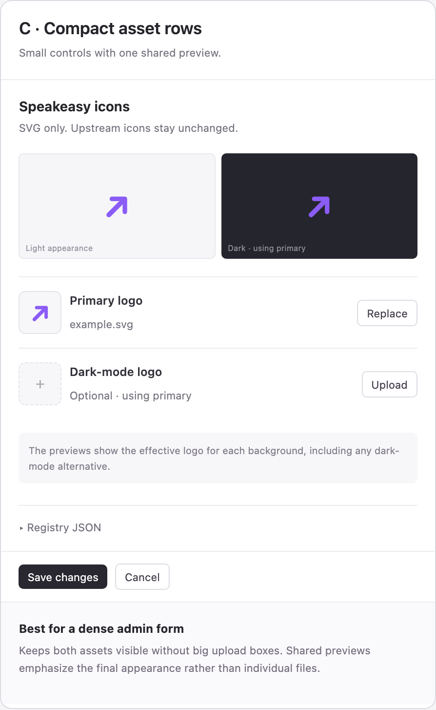

# Catalog entry SVG icons

## Goal and scope

Allow staff to upload and manage Speakeasy-curated catalog-entry icons in Admin and expose publicly accessible assets through catalog-entry metadata. Customer-dashboard icon rendering and selection are explicitly out of scope.

This design was agreed through brainstorming. Implementation begins only after review of this written spec and implementation planning.

## Data contract

Preserve upstream `server.icons` unchanged. Add curated icons to the catalog entry's envelope `_meta`, not to `server._meta`:

```json
{
  "_meta": {
    "com.speakeasy.ai/icons": {
      "default": {
        "src": "https://assets.example/catalog/default.svg",
        "mimeType": "image/svg+xml",
        "sizes": ["any"]
      },
      "dark": {
        "src": "https://assets.example/catalog/dark.svg",
        "mimeType": "image/svg+xml",
        "sizes": ["any"]
      }
    }
  }
}
```

There are two slots: `default` for the primary logo and `dark` for an optional dark-background alternative. The primary logo is used on light backgrounds and is also the fallback on dark backgrounds. There is no curated `light` slot and no mode selector. The slot key is authoritative; icon objects do not contain a redundant `theme` field. Removing the last slot removes the namespaced key without removing unrelated metadata.

Persist curated values independently of upstream synchronization and merge them into catalog list and detail response envelopes. Upstream refreshes must neither overwrite nor remove this namespace. Do not accept upstream values as authoritative for the staff-managed namespace. Slot updates must preserve other slots and unrelated metadata.

Future consumer selection is conceptually:

- Light background: curated `default`, upstream light-theme match, then upstream unthemed icon.
- Dark background: curated `dark`, curated `default`, upstream dark-theme match, then upstream unthemed icon.

This describes intended semantics only; implementing consumer selection is deferred.

## Admin experience

Add an Icons section to the existing catalog-entry editor, labeled as Speakeasy-curated icons and distinct from upstream icons:

Selected visual direction: **Option C — compact asset rows with shared previews**.



This screenshot is a layout reference, not a complete interaction specification; the controls and behavior below are authoritative.

Place a shared light/dark preview pair above two compact asset rows. The previews show the effective curated logo for each background: primary on light, dark alternative (or primary fallback) on dark. Label the dark preview "Using primary" when it falls back; show an empty state when no applicable curated logo exists.

- **Primary logo** (`default`): compact row with thumbnail, filename, and upload or replace/remove controls. Helper text: "Used for both themes unless you add a dark-mode logo."
- **Dark-mode logo (optional)** (`dark`): compact row with thumbnail, filename when present, and upload or replace/remove controls. When absent, indicate that the primary logo is the fallback if one exists.

Both rows remain visible. Avoid large upload cards or a disclosure step for the dark alternative. Keep the existing JSON editor below the icon controls and use one shared Save changes action for the draft.

Offer upload, replace, and remove for each slot. No separate light-logo upload or one-logo/two-logo mode selector. Accept SVG only. Show accepted assets using `img` elements, never injected SVG markup.

Use the existing editor's save conventions. Failed validation or saving must leave the currently saved icon intact and provide an actionable error. Only show persisted success after the metadata write succeeds. No whole-set override or restore-upstream action is needed because upstream data is never modified.

## Architecture and data flow

Reuse the existing platform image storage and public serving infrastructure rather than introducing a separate bucket or CDN by default. Existing reference points are `server/internal/assets/adminhandlers.go` and the issuer logo upload UI in `client/admin/src/pages/remote-session-issuers/IssuerEditor.tsx`.

The current platform image allowlist excludes SVG; safe SVG support is required, not merely an Admin file-input change.

Flow: authorized staff selects a slot and file; the backend validates and sanitizes the SVG; the accepted asset is stored; its public URL and icon metadata are associated with the exact catalog entry and slot; catalog responses expose the curated namespace. A failed metadata association may leave an unreferenced asset, but must not alter the saved icon. Reuse existing asset lifecycle behavior; no new garbage-collection subsystem is part of this slice.

Use distinct content-addressed or versioned URLs for changed assets so replacements do not require cache invalidation. Do not delete shared asset bytes when removing a slot. Public reads must not require staff credentials; writes must require platform-wide staff authorization. Validate asset associations so arbitrary private or tenant-owned assets cannot be published through this feature.

## SVG safety

SVG-only applies to new curated uploads, not upstream icons.

- Enforce server-side file-size limits and validate actual SVG content, not just filename or declared MIME type.
- Use Go’s standard-library `encoding/xml` to validate and reserialize a strict allowlisted static SVG subset. This approach was explicitly approved during planning: no new dependency or runtime, but the security-sensitive policy is maintained in this repository. Do not use regex-based sanitization or an HTML sanitizer.
- Reject unsupported features rather than silently stripping them. Initially support paths, basic shapes, groups, and allowlisted presentation attributes. Reject CSS stylesheets/style attributes, text/fonts, gradients, filters, animation, links, and resource references; tell staff to re-export a static, flat-path SVG. Bound XML depth and token count as well as file size.
- Reject unsafe or unsupported content with clear errors. Prevent scripts, event handlers, executable URLs, external resource references, and embedded HTML from surviving into served assets. Disable XML external entity and external document resolution.
- Preview only the accepted/sanitized asset through `img`, not raw uploaded markup.
- Serve SVG responses with `image/svg+xml`, `X-Content-Type-Options: nosniff`, and restrictive asset-level CSP that blocks scripts and sandboxes document execution without script permissions. Allow only styling required for static SVG appearance, not external resource loading.
- Verify these headers on the actual public asset path, including any redirects or CDN serving layer. The Admin document's CSP does not protect an SVG opened directly at its asset URL.

Sanitization and serving headers are complementary defenses. SVG support must not be enabled until both are verified.

## Other product surfaces

Assess staff Admin MCP parity for managing exact catalog-entry slots, including a safe upload flow and matching authorization. Reuse existing platform-upload capabilities where appropriate rather than inventing a second upload mechanism.

Assess Platform MCP catalog read contracts so curated envelope metadata is preserved where catalog entries are exposed. No customer-facing write capability is implied.

No new dashboard page or navigation is planned. Assess demo seed coverage and add representative curated icon metadata where the existing seed models catalog entries, without external customer identifiers or fragile remote dependencies.

## Alternatives considered

- Rewrite upstream `server.icons`: rejected because curated presentation data should remain distinguishable from publisher data.
- Whole-set override: superseded by namespaced slots, preserving upstream data and allowing per-theme fallback.
- Three upload slots (`default`, `light`, `dark`): simplified to a primary logo plus an optional dark-mode alternative.
- One-logo/two-logo mode selector: unnecessary; adding a dark-mode alternative expresses the choice directly.
- Separate catalog asset infrastructure/CDN: defer unless inspection shows existing public serving cannot satisfy safety or hosting requirements.
- URL-only entry: does not satisfy the requested upload workflow.
- Raster uploads, conversion, resizing, SVG editing: out of scope.

## Verification

Focused tests must cover:

1. Creating, replacing, and removing each slot; omitting the empty namespace.
2. Preserving other slots, unrelated envelope metadata, and upstream `server.icons`.
3. Curated metadata surviving upstream sync, including conflicting upstream metadata.
4. Consistent namespace serialization in catalog list and detail responses.
5. Staff-only writes and rejection of inappropriate asset associations.
6. Valid static SVG uploads and clear rejection of non-SVG, malformed, oversized, or unsafe inputs.
7. Script, event-handler, embedded-HTML, external-reference, and XML-entity payloads never being served as active content.
8. Public reads without authentication and correct MIME, CSP, and nosniff headers on the actual serving response.
9. Primary-logo and optional dark-mode controls, preview backgrounds, fallback messaging, and failure behavior preserving saved icons. No curated `light` slot or redundant `theme` fields in the contract.
10. Relevant Admin MCP and catalog-read contract coverage.

## Implementation planning checks

Resolve these repository-specific choices during planning before implementation: exact catalog persistence and response assembly points; existing asset size limit and public serving topology; the strict XML allowlist and its limits; existing editor save semantics; staff MCP upload/association tools; seed representation. These are technical discovery items, not additional product scope.
