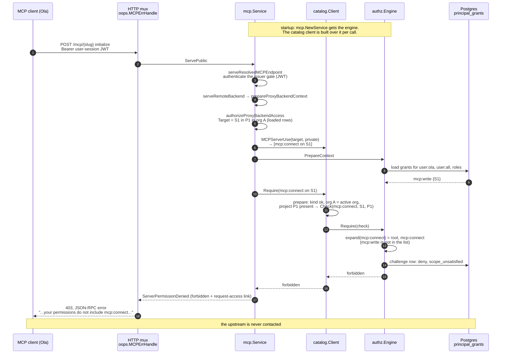
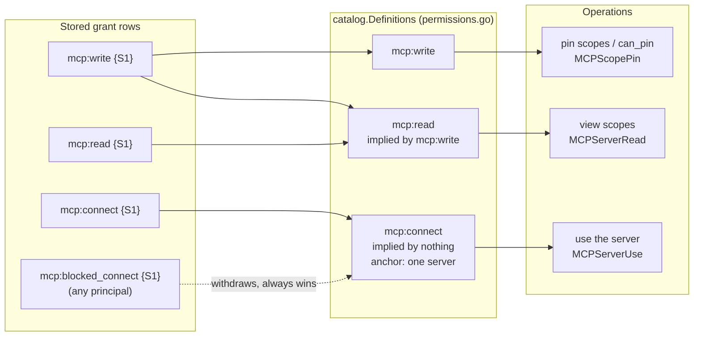

# Walkthrough 01: an editor configures an MCP server but cannot use it

This walkthrough follows one HTTP request through the code. The caller can configure a private MCP server, then tries to use it, and gets a 403. Each step names the file and line it describes, from `server/` on this branch. The outcomes were checked by running `TestConfigureWithoutUse` in `server/internal/mcp/configure_without_use_test.go`, the slice 1 acceptance test.

## The setup

The setup has one organization with project P1. P1 holds S1, a private MCP server: it is issuer-gated and backed by a remote upstream.

The caller is Ola (synthetic). Ola holds one stored grant, as a row in `principal_grants`:

| principal | scope | selectors |
| --- | --- | --- |
| `user:ola` | `mcp:write` | `{"resource_kind":"mcp","resource_id":"<S1>"}` |

Ola can do two things with that grant:
- open S1's scope settings and pin scopes (`setServerScopePin`), which succeeds;
- send `initialize` to S1's endpoint with a valid user session, which is **refused with 403**.

Configuring a server never grants using it.

## The picture



How stored scopes turn into the permissions a check accepts:



Before this slice, the engine also had `mcp:write → mcp:connect` and `mcp:read → mcp:connect` edges. A direct user grant also outranked a block inherited from a role. Both are gone for these three permissions.

## Step by step

### 0. Startup

The server builds one `authz.Engine` and hands it to every service. In `cmd/gram/start.go:1028`:

```go
authzEngine := authz.NewEngine(
```

The scope-pin service wraps the engine in a catalog client once, in `internal/remotemcp/impl.go:96`:

```go
authzClient:           catalog.NewEngineClient(authzEngine),
```

The MCP service keeps the engine (`cmd/gram/mcp_service.go:144`) and builds the client per call. The client is stateless and caches nothing across requests, so that costs almost nothing.

### 1. The route

`internal/mcp/impl.go:845` registers the public endpoint behind the MCP error handler. That handler later turns the returned error into the HTTP response:

```go
o11y.AttachHandler(mux, "POST", PublicServerRoute, oops.MCPErrHandle(service.logger, service.ServePublic).ServeHTTP)
```

### 2. Resolve the endpoint and authenticate

`ServePublic` (`internal/mcp/impl.go:1173`) resolves `{slug}` to the endpoint and server rows and calls `serveResolvedMCPEndpoint` (`internal/mcp/serveendpoint.go:162`).

Because S1 is issuer-gated, the bearer must be a user-session JWT for S1's issuer. Once it is validated, the request's auth context says who Ola is and which organization is active.

The remote branch continues in `serveRemoteBackend` (`serveendpoint.go:739`). That calls `prepareProxyBackendContext` (`serveendpoint.go:915`), which reaches the authorization call at `serveendpoint.go:1013`:

```go
ctx, err = s.authorizeProxyBackendAccess(ctx, logger, mandatorySurfaceProxiedConnect, organizationID, endpoint.ProjectID, mcpServer)
```

`organizationID`, `endpoint.ProjectID` and `mcpServer` all come from rows loaded for this endpoint, not from the request body.

### 3. Describe the target and ask what use requires

`internal/mcp/serveendpoint.go:1056` describes S1 as a catalog target:

```go
target := catalog.MCPServerTarget(organizationID, projectID.String(), mcpServer.ID.String())
```

`MCPServerTarget` (`internal/authz/catalog/mcpserver.go:12`) records S1, its project and its organization, each tagged with the organization:

```go
Resource: ResourceRef{OrganizationID: organizationID, Kind: authz.ResourceKindMCP, ID: serverID},
Ancestors: []ResourceRef{
	{OrganizationID: organizationID, Kind: authz.ResourceKindProject, ID: projectID},
	{OrganizationID: organizationID, Kind: authz.ResourceKindOrg, ID: organizationID},
},
```

`requireProxyBackendAccess` (`serveendpoint.go:1071`) asks the catalog what using this server requires. For a private server, `MCPServerUse` (`catalog/mcpserver.go:55`) answers with exactly one request, and no other permission can stand in for it:

```go
case MCPServerPrivate:
	return []Request{{Permission: authz.ScopeMCPConnect, Target: target}}, nil
```

A public server needs nothing, so the function returns before any grant is loaded.

### 4. Load Ola's grants

`serveendpoint.go:1084` calls `s.authz.PrepareContext(ctx)` (`internal/authz/engine.go:112`). That resolves Ola's principals (`user:all`, `user:ola`, and Ola's roles) and loads their `principal_grants` rows into the request context. For Ola this is one row: `mcp:write {S1}`. Nothing is cached across requests.

### 5. The catalog client checks the request before reading grants

`serveendpoint.go:1092`:

```go
decision, err := catalog.NewEngineClient(s.authz).Require(ctx, requests...)
```

`Client.Require` (`internal/authz/catalog/client.go:137`) first calls `prepare` (`client.go:162`). For each request, `prepare` checks the following against the definition (`catalog/permissions.go:59`) before any grant is read:
- the permission has a definition;
- the target is one concrete server;
- the target's organization is the caller's active organization, or the result is `cross_tenant`;
- exactly one project ancestor and one organization ancestor are present, both in that organization, or the result is `missing_fact`, which never allows.

Ola's request passes all four. The output is one engine check:

```go
checks = append(checks, authz.MCPCheck(def.Name, resource.ID, projectID))
// → Check{Scope: mcp:connect, ResourceID: <S1>, Dimensions: {project_id: <P1>}}
```

### 6. The engine decides

`Require` hands the checks to the backend (`catalog/backend.go:34`), which calls the existing `Engine.Require`. Denials and allows are therefore recorded in the authorization challenge log the same way as for any other check:

```go
func (b engineBackend) enforce(ctx context.Context, checks []authz.Check) error {
	return b.engine.Require(ctx, checks...)
}
```

`Engine.Require` (`internal/authz/engine.go:211`) evaluates through `grantAuthorization.evaluate` (`internal/authz/context.go:188`) and `evaluateGrantCheck` (`internal/authz/grants.go:402`). These look for a grant matching any of the check's expansions:

```go
grant, matchedCheck := matchingGrant(grants, check.expand())
```

`Check.expand` (`internal/authz/access.go:92`) lists the scopes that satisfy the check: `root`, the scope itself, and the scopes `scopeExpansions` lists for it. For `mcp:connect`, that list is now empty (`internal/authz/scopes.go:288`):

```go
ScopeMCPConnect:              nil,
```

So the only candidates are `root {S1}` and `mcp:connect {S1}`. Ola's `mcp:write {S1}` matches neither, and `grant == nil`. `evaluateRequired` writes a deny challenge with reason `scope_unsatisfied` and returns forbidden (`internal/authz/engine.go:284–303`):

```go
reason := authzrepo.ReasonScopeUnsatisfied
...
return e.mapError(ctx, Denied(check.Scope, check.selector()))
```

`catalog/permissions.go` declares the same rule: `mcp:connect` has `ImpliedBy: nil`. `TestDefinitionsMatchEngine` (`catalog/client_test.go`) fails if `scopes.go` and the definitions ever disagree.

### 7. Back out to HTTP

The forbidden error returns through `Client.Require` unchanged. `requireProxyBackendAccess` (`serveendpoint.go:1098`) replaces it with the MCP-specific message and a request-access link (`internal/mcpaccess/errors.go:20`):

```go
return ctx, fmt.Errorf("authorize MCP server access: %w", mcpaccess.ServerPermissionDenied(err, s.requestAccessURL(ctx, mcpServer.ID.String(), serverName)))
```

`oops.MCPErrHandle` (`internal/oops/mcp.go:20`) turns the forbidden code into **HTTP 403** with a JSON-RPC error body. This is the error the test run returned:

```
authorize MCP server access: access to this MCP server was restricted because your
permissions do not include mcp:connect. Ask an organization administrator to grant access.

Request access:
http://…/request-access?resource_id=<S1>&resource_name=…&scope=mcp%3Aconnect
```

S1's upstream receives no request. The test checks this with a hit counter on the upstream.

## The other half: Ola can still configure S1

`setServerScopePin` (`internal/remotemcp/serverscopes.go:62`) builds its requests with the same catalog:

```go
authCtx, logger, mcpServerID, err := s.authorizeServerScopes(ctx, payload.McpServerID, func(target catalog.Target) []catalog.Request {
	return catalog.MCPScopePin(target, nil)
})
```

`MCPScopePin` asks for `mcp:write`, which Ola holds on S1.

After the server row is loaded, `authorizeSharingServers` (`serverscopes.go:230`) asks again. This time the request covers every server that shares S1's upstream URL, because the pin applies to all of them. Ola holds write on S1b too, so the pin is written.

`getServerScopes` reports `can_pin` through `canPin` (`serverscopes.go:243`). It uses the same request builder with `Authorize`, which does not record a challenge. The button and the write cannot disagree.

## Counter-case: Cai holds a connect grant

Cai (synthetic) holds `user:cai mcp:connect {"resource_kind":"mcp","resource_id":"<S1>"}` and nothing else. Cai follows the same path as Ola up to step 6. There, `expand` yields `mcp:connect {S1}`, which matches Cai's row: selector keys the grant omits, such as `project_id`, are not compared. The engine writes an allow challenge.

`Client.Require` then calls `evaluate` (`Engine.EvaluateEach`) to build the `Decision`. The matched grant names one server, which `mcp:connect`'s definition allows (`AllowedAnchors: [mcp]`), so `Basis` is empty.

`prepareProxyBackendContext` continues, the upstream receives `initialize`, and Cai gets **200**. Cai cannot pin S1's scopes: `getServerScopes` and `setServerScopePin` both return 403, because connect implies neither read nor write.

## How grant rows change the result

Each row is a separate caller on S1, or on S2, a second private server in P1. The results come from `TestConfigureWithoutUse` and `catalog/client_test.go`.

| Stored grants | View scopes of S1 | Pin S1 (`can_pin`) | Use S1 | Use S2 | Why |
| --- | --- | --- | --- | --- | --- |
| `user mcp:write {S1}, {S1b}` | 200 | allowed (true) | **403** | 403 | write implies read, never connect |
| `user mcp:connect {S1}` | 403 | 403 | 200 | 403 | connect names one server and implies nothing else |
| `user mcp:connect {S1}`, `mcp:write {S1}, {S1b}` + role `mcp:blocked_connect {S1}`, `mcp:blocked_write {S1}` | 200 | 403 (false) | 403 | 403 | a block always wins, even over a direct user grant (`BlockWins`, `precedence.go:51`) |
| `user mcp:connect {S1, project_id:P1}`, `mcp:connect {S2, project_id:P2}` | 403 | 403 | 200 | 403 | the check carries `project_id: P1`; the S2 grant is bound to P2 |
| built-in Member role `mcp:connect {*}` | n/a | n/a | 200 | 200 | legacy broad grant: still allows, `Decision.Basis = legacy_broad_grant`, logged at info |
| org A rows naming SB, a server in organization B | n/a | 404, nothing written | 403 | n/a | the pin loads SB only inside the session's project; use is refused at the same authz step |
| none | 403 | 403 | 403 | 403 | no grant |

## Where to look next

- `catalog/doc.go` describes the package and maps its files.
- `catalog/client_test.go` holds the rows above as unit cases, plus a check that `Authorize` and `Require` agree.
- The review packet lists what this slice does not yet cover: mirrors such as the access list and the dashboard, the per-organization rollout gate, and stored agent policies.
