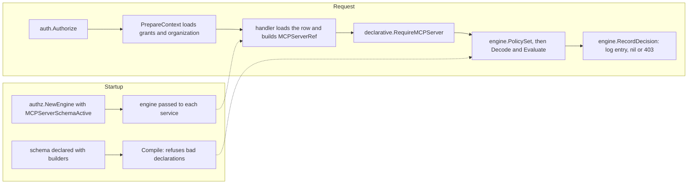

# How option D behaves: a step-by-step guide

This guide grows one step at a time, in the order Tiago asks for them. Each section answers one question about option D. Option D is a declarative relationship schema evaluated over today's `principal_grants` rows. Each section shows the code that expresses the answer, then explains in plain terms what it does when a request arrives.

## How to read it

- **Implemented** means the code is on this branch and covered by tests. The section links the file and the test.
- **Sketched** means the code shows what option D *would* look like. It is not on the branch, or is on it only as far as the example needs. Sketched code may not compile as written.
- Every section ends with what it does *not* cover, and the cases where the answer would change.
- This guide describes option D. It doesn't compare D with other options or recommend it.

## Where the pieces are

| Piece | File | What it does |
| --- | --- | --- |
| Builders and compiler | `relschema/builders.go`, `relschema/schema.go` | `s.NewType`, `s.Grant`, `s.Permission` and so on. `Compile` rejects declarations that don't make sense. |
| Decoder | `relschema/decode.go` | Turns one stored `principal_grants` row into a relationship, or fails. |
| Evaluator | `relschema/eval.go` | Answers allowed, denied or undetermined for one permission on one object, with a trace. |
| Schemas | `mcp_server_schema.go` | The policy for one resource type, written with the builders. |
| Entry points | `mcp_server_access.go` | What services call (`RequireMCPServer`, `MCPServerCapabilities`). |
| Walkthroughs | `walkthroughs/` | A long trace of one request through all of the above. |

## Steps

1. [Scaffolding: how checks are defined, and how handlers reach the authorizer](#step-1-scaffolding)
2. [What the anchor gives us, and five access scenarios](#step-2-anchors-and-five-access-scenarios)

---

## Step 1: Scaffolding

**Status: implemented** (slice 1, on this branch). This step covers only the frame: where a check is defined, what object handlers hold, how grants reach a request, and what a call looks like. The rules themselves come in later steps.

### 1.1 A check is defined once, in a schema

Today a check is built at each call site from a scope string: `authz.MCPCheck(authz.ScopeMCPConnect, id, projectID)`. In option D, the call site names a **permission on a type**. What that permission means is declared once, in a schema file written with builders:

```go
// mcp_server_schema.go (abridged)
s.NewType("mcp_server", s.Parent("project"), s.StoredKind(authz.ResourceKindMCP),
    s.Grant("connector", s.StoredAs("mcp:connect"), s.AnchoredAt("mcp_server"), ...),
    s.Block("connect_blocked", s.StoredAs("mcp:blocked_connect"), ...),
    s.Permission("connect", s.Union(s.Rel("connector"), root), s.ExcludedBy("connect_blocked")),
)
```

The pieces of a declaration:

- **A type** (`s.NewType`) is a kind of object, with its parent (`s.Parent`). Here an MCP server sits in a project, which sits in an organization.
- **A grant** (`s.Grant`) says which stored scope in `principal_grants` gives which relation (`s.StoredAs`), and where a row may attach (`s.AnchoredAt`).
- **A block** (`s.Block`) is the same for a `blocked_` scope.
- **A permission** (`s.Permission`) is what code asks for. It is computed from relations, never stored.

Code asks for permissions through typed constants, so a call site can't pass a raw scope string:

```go
type MCPServerPermission string

const (
    MCPServerRead    MCPServerPermission = "read"
    MCPServerEdit    MCPServerPermission = "edit"
    MCPServerConnect MCPServerPermission = "connect"
)
```

**The schema is compiled once, at startup.** It is a package-level value, so a bad declaration stops the server from starting:

```go
var mcpServerSchema = mustCompileMCPServerSchema() // panics on error
```

`relschema.Compile` refuses, among other things:

- a parent that doesn't exist, or a chain that doesn't end at the organization;
- an anchor that isn't the type or one of its ancestors;
- a permission that names an unknown relation, or excludes something that isn't a block;
- a stored scope mapped twice;
- **a registered scope that is neither read by the schema nor declared out of it.** Adding a scope to `authz/scopes.go` without deciding where it belongs fails startup.

### 1.2 Handlers keep the client they already have

There is no new client. Option D reuses the existing `*authz.Engine`, which every service already receives through its constructor:

```go
// cmd/gram/start.go
authzEngine := authz.NewEngine(logger, db, challengeLoggingEnabled, roleClient,
    authz.EngineOpts{
        // ...existing admission options...
        // No organization evaluates MCP servers through the relationship schema yet.
        MCPServerSchemaActive: nil,
    })

mcpServersService := mcpservers.NewService(logger, tracerProvider, db, sessionManager, authzEngine, ...)
```

```go
// mcpservers/impl.go
type Service struct {
    // ...
    authz *authz.Engine
}
```

The only new engine option is `MCPServerSchemaActive`, a function that answers "does this organization use the schema?". It is `nil`, meaning no, at all four `cmd/gram` construction sites, so production behavior is unchanged.

The declarative package doesn't wrap or replace the engine. Its functions take the engine as an argument and use a few small hooks it exposes (`authz/policy_set.go`):

| Hook | What it gives the declarative package |
| --- | --- |
| `PolicySet(ctx)` | The caller's loaded grants, grouped by policy, and the organization they were loaded for |
| `MCPServerSchemaActive(ctx)` | Whether the caller's organization is switched on |
| `RecordDecision(ctx, check, decision)` | Writes the same challenge log entry as `Require`, and returns the same 403 |
| `MapError(ctx, err)` | The same error mapping as `Require` |
| `IsAPIKeyGrant(grant)` | Whether a row belongs to a legacy API key, whose rows match strictly |

So policy lives in `declarative/`, while identity, grant loading, logging and error responses stay in the engine.

### 1.3 Grants reach the request the same way as today

Nothing new runs per request before the handler. The Goa security handler, `auth.Authorize` (`internal/auth/auth.go`), authenticates the caller and then calls `s.authz.PrepareContext(ctx)`. This:

- resolves who the caller is (the user and their roles, or an agent's policies);
- loads their `principal_grants` rows into the context;
- records which organization those rows belong to. That last part is new in option D, and lets the evaluator refuse grants loaded for one organization being used in another.

A few MCP serving paths that don't go through Goa call `PrepareContext` themselves, as they already did.

### 1.4 The call shape

A handler loads the object from its own tenant-scoped query, builds a reference from that row, and asks one question:

```go
server := declarative.MCPServerRef{
    ID:             row.ID.String(),
    ProjectID:      row.ProjectID.String(),
    OrganizationID: organizationID,
}
if err := declarative.RequireMCPServer(ctx, s.authz, declarative.MCPServerConnect, server); err != nil {
    return err // already a 403, logged like any other denial
}
```

- **The reference comes from the database, not the request.** `MCPServerRef` carries the server's real project and organization, so the evaluator can check the tenant itself.
- **`RequireMCPServer` enforces a permission.** If the organization isn't switched on, it runs the legacy check unchanged.
- **`MCPServerCapabilities(ctx, s.authz, server)` reports.** It returns `{Read, Edit, Connect}` for API responses, from the same decision function, so what's reported can't drift from what's enforced.

The core types, from the outside in:

| Type | Package | Role |
| --- | --- | --- |
| `MCPServerRef`, `MCPServerPermission`, `Capabilities` | `declarative` | What a handler passes and gets back |
| `authz.PolicySet` | `authz` | The caller's grants, by policy, bound to one organization |
| `relschema.Row` → `relschema.Relationship` | `relschema` | One stored row, and what the schema makes of it (`Decode`) |
| `relschema.Object` | `relschema` | The object being checked, with its ancestors |
| `relschema.Decision` | `relschema` | Allowed, denied or undetermined, with a reason and a trace (`Evaluate`) |



### Not settled by this step

- **Entry points are named per type** (`RequireMCPServer`). With a second type, they'd become one `Require(ctx, engine, permission, ref)`, where the reference names its type. That isn't built.
- **Activation is a callback with no implementation.** Where its answer would come from (a feature flag, an organization column) isn't decided.
- **One schema value per area.** Whether every type goes in one compiled schema, or each area gets its own, is open. With one schema, every row in a policy has to decode for every check.

---

## Step 2: Anchors, and five access scenarios

Every scenario below is a case in `guide_scenarios_test.go`, run against exactly the stored rows shown. The fixture is one organization. Project **PA** holds servers **S1**, **S2** and **C**. Another project, **PO**, holds **SO**.

### 2.1 What the anchor gives us

An **anchor** is the object a stored row attaches to. Every `principal_grants` row attaches to exactly one object, and `Decode` works out which from the row's selector:

| Stored selector | Anchor | Covers |
| --- | --- | --- |
| `{resource_kind: mcp, resource_id: S1}` | the server `mcp_server:S1` | that one server |
| `{resource_kind: mcp, resource_id: *, project_id: PA}` | the project `project:PA` | every server in PA |
| `{resource_kind: mcp, resource_id: *}` | the organization the grants were loaded for | every server in the organization |

When a check runs, the evaluator looks up the object's chain (`mcp_server:S1` in `project:PA` in `organization:A`). A row applies if its anchor is anywhere on that chain. That's the whole inheritance rule: a row covers its anchor and everything inside it.

The declaration then says **where each grant is allowed to anchor**:

```go
anywhere := s.AnchoredAt(server, project, org)

s.Grant("editor", s.StoredAs("mcp:write"), anywhere, ...)            // one server, a project, or the organization
s.Grant("connector", s.StoredAs("mcp:connect"),
    s.AnchoredAt(server), s.LegacyAnchoredAt(project, org), ...)     // one server; broader rows only as legacy
```

So the anchor gives three things:

1. **Inheritance without expansion code.** Covering "every server in a project" is a matter of where the row sits, not a rule that copies or expands grants.
2. **A per-grant limit on breadth.** If a grant isn't declared `AnchoredAt` some level, a row at that level is rejected when it's decoded, which fails the check. It isn't quietly widened or skipped. `LegacyAnchoredAt` is a third answer: honor the row, but label it "legacy broad grant" in every trace until it's migrated. This is how the slice 1 decision ("honor wildcard connect as legacy") is written down.
3. **The tenant boundary.** An organization-wide row anchors at the organization *the grants were loaded for*, never at whatever the request names. A server in another organization isn't on the chain of any row, and is refused before rows are looked at.

**Narrowing is different from anchoring.** `{resource_id: S3, project_id: P1}` anchors at S3 and adds a condition: S3 must be in P1. If S3 is in P2, the row doesn't apply. `s.NarrowableBy(project)` declares that a grant may carry that condition.

### 2.2 The five scenarios

| # | Scenario | Status |
| --- | --- | --- |
| 1 | Role A may connect to every server in project A | **Implemented, as a legacy shape** |
| 2 | Role A may manage one server in project A, which also grants view | **Implemented** |
| 3 | Role B is blocked from server C; a user in both roles reaches everything but C | **Implemented** |
| 4 | Role C may connect to every server, read-only tools only | **Connect: implemented. Tool restriction: in the evaluator, not called from the tool path** |
| 5 | Role D may connect to server A and use only tool A | **Connect: implemented. Tool restriction: in the evaluator, not called from the tool path** |

"A user in both roles" needs nothing special. When the caller's grants load (step 1.3), the user's roles are resolved and the rows of both roles go into the user's one policy. The evaluator sees one set of rows.

#### Scenario 1: connect to every server in a project

```
role:A  mcp:connect  {resource_kind: mcp, resource_id: *, project_id: PA}
```

| Check | Outcome |
| --- | --- |
| connect S1, S2, C | allowed, trace says "legacy broad grant" |
| connect SO (project PO) | denied |

The row anchors at `project:PA`. `connector` lists the project only under `LegacyAnchoredAt`, so it's honored and labelled. Both RFC documents say a connect assignment should name one server, and that's why it's labelled.

To make project-wide connect a first-class shape, the declaration would change by one argument. That isn't on the branch:

```go
s.Grant("connector", s.StoredAs("mcp:connect"), s.AnchoredAt(server, project), s.LegacyAnchoredAt(org), ...)
```

#### Scenario 2: manage one server, which includes viewing it

```
role:A  mcp:write  {resource_kind: mcp, resource_id: S1, project_id: PA}
```

| Check | Outcome |
| --- | --- |
| edit S1 | allowed |
| read S1 | allowed |
| connect S1 | **denied** |
| edit S2, read S2 | denied |

The view comes from the permission, not from a second row:

```go
s.Permission("read", s.Union(s.Rel("viewer"), s.Rel("editor"), root), s.ExcludedBy("read_blocked")),
s.Permission("edit", s.Union(s.Rel("editor"), root), s.ExcludedBy("edit_blocked")),
s.Permission("connect", s.Union(s.Rel("connector"), root), s.ExcludedBy("connect_blocked")),
```

`read` includes `editor`, so managing implies viewing. `connect` doesn't include `editor`, so managing doesn't imply using. Today it does, through `scopeExpansions`.

#### Scenario 3: a block in one role beats an allow in another

```
role:A  mcp:connect          {resource_kind: mcp, resource_id: *, project_id: PA}
role:B  mcp:blocked_connect  {resource_kind: mcp, resource_id: C}
```

For a user holding both roles:

| Check | Outcome |
| --- | --- |
| connect S1, S2 | allowed |
| connect C | denied, trace says "withdrawn by a matching block" |

`connect` is `(connector ∪ root) − connect_blocked`. The block row anchors at C, so it's on C's chain only. A block wins whichever principal holds it. In particular, a connect row given directly to the user wouldn't outrank role B's block either. Today it would (precedence rule R8).

#### Scenario 4: every server, read-only tools

```
role:C  mcp:connect  {resource_kind: mcp, resource_id: *, disposition: read_only}
```

| Check | Facts | Outcome |
| --- | --- | --- |
| connect S1, connect SO | none (opening the connection) | allowed, as a legacy organization-wide row |
| connect S1 for tool `search` | `tool: search, disposition: read_only` | allowed |
| connect S1 for tool `delete_all` | `tool: delete_all, disposition: destructive` | denied |
| connect S1 for an unannotated tool | `tool: unannotated` (no disposition) | **allowed** (see the gap below) |

The declaration lets `connector` rows carry `tool` and `disposition`:

```go
toolLimited := s.ConstrainedBy(authz.SelectorKeyTool, authz.SelectorKeyDisposition)
```

A row with a constraint applies only when the request carries a matching fact. When the request carries no fact for that key, the question is about the server as a whole, and an ordinary allow applies. That's how a read-only role can open the connection before any tool is chosen.

**What's not built:** nothing passes tool facts to the schema yet. `RequireMCPServer` evaluates with no facts. `tools/call` and `tools/list` go through the `remotemcp` interceptors, which still use the legacy `MCPToolCallCheck`. The tool rows in the table were evaluated by calling the schema directly in the test. A `RequireMCPTool(ctx, engine, server, tool, disposition)` entry point would be needed (sketched, not on the branch).

**A gap, shared with today's code:** a tool with no annotation has an empty disposition. In the schema, that's a missing fact, so the read-only row applies. Today, `MCPToolCallCheck` leaves an empty disposition out of the check, and the legacy selector match skips keys the check doesn't name. So today's check allows it too. The test asserts both, with `authz.GrantsSatisfy` for the legacy side. To close it, an unannotated tool would need a disposition of its own, such as `unknown`, that no read-only row matches.

#### Scenario 5: one server, one tool

```
role:D  mcp:connect  {resource_kind: mcp, resource_id: A, tool: tool_a}
```

| Check | Facts | Outcome |
| --- | --- | --- |
| connect A | none | allowed |
| connect S2 | none | denied |
| connect A for `tool_a` | `tool: tool_a` | allowed |
| connect A for `tool_b` | `tool: tool_b` | denied |

(Server A is `S1` in the test.) This is the same mechanism as scenario 4, and has the same limit: the connection check is wired, and the tool check isn't. The row anchors at the server, so it's a first-class shape with no legacy label.

### Not settled by this step

- **Whether project-wide connect should be first-class** (scenario 1). It's a one-argument change, but it reverses what the RFC and plan say.
- **A tool-call entry point**, so the tool restrictions in scenarios 4 and 5 are decided by the schema rather than the legacy interceptors.
- **Unannotated tools under a read-only row** (the scenario 4 gap). This is a behavior decision, not just code.
- **Rows that combine `tool` and `disposition`** must match both. That follows from the code, but it isn't one of the five scenarios and isn't tested here.
