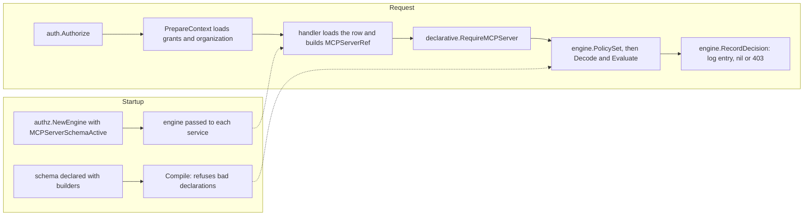

# How option D behaves: a step-by-step guide

This guide grows one step at a time, in the order Tiago asks for them. Each section answers one question about option D. Option D is a declarative relationship schema evaluated over today's `principal_grants` rows. Each section shows the code that expresses the answer, then explains in plain terms what it does when a request arrives.

## How to read it

- **Implemented** means the code is on this branch and covered by tests. The section links the file and the test.
- **Sketched** means the code shows what option D *would* look like. It is not on the branch, or is on it only as far as the example needs. Sketched code may not compile as written.
- Every section ends with what it does *not* cover, and the cases where the answer would change.
- This guide describes option D. It doesn't compare D with other options or recommend it.

## Where the pieces are

| Piece | File | What it does |
| --- | --- | --- |
| Builders and compiler | `relschema/builders.go`, `relschema/schema.go` | `s.NewType`, `s.Grant`, `s.Permission` and so on. `Compile` rejects declarations that don't make sense. |
| Decoder | `relschema/decode.go` | Turns one stored `principal_grants` row into a relationship, or fails. |
| Evaluator | `relschema/eval.go` | Answers allowed, denied or undetermined for one permission on one object, with a trace. |
| Schemas | `mcp_server_schema.go` | The policy for one resource type, written with the builders. |
| Entry points | `mcp_server_access.go` | What services call (`RequireMCPServer`, `MCPServerCapabilities`). |
| Walkthroughs | `walkthroughs/` | A long trace of one request through all of the above. |

## Steps

1. [Scaffolding: how checks are defined, and how handlers reach the authorizer](#step-1-scaffolding)
2. [What the anchor gives us, and five access scenarios](#step-2-anchors-and-five-access-scenarios)

---

## Step 1: Scaffolding

**Status: implemented** (slice 1, on this branch). This step covers only the frame: where a check is defined, what object handlers hold, how grants reach a request, and what a call looks like. The rules themselves come in later steps.

### 1.1 A check is defined once, in a schema

Today a check is built at each call site from a scope string: `authz.MCPCheck(authz.ScopeMCPConnect, id, projectID)`. In option D, the call site names a **permission on a type**. What that permission means is declared once, in a schema file written with builders:

```go
// mcp_server_schema.go (abridged)
s.NewType("mcp_server", s.Parent("project"), s.StoredKind(authz.ResourceKindMCP),
    s.Grant("connector", s.StoredAs("mcp:connect"), s.AnchoredAt("mcp_server"), ...),
    s.Block("connect_blocked", s.StoredAs("mcp:blocked_connect"), ...),
    s.Permission("connect", s.Union(s.Rel("connector"), root), s.ExcludedBy("connect_blocked")),
)
```

The pieces of a declaration:

- **A type** (`s.NewType`) is a kind of object, with its parent (`s.Parent`). Here an MCP server sits in a project, which sits in an organization.
- **A grant** (`s.Grant`) says which stored scope in `principal_grants` gives which relation (`s.StoredAs`), and where a row may attach (`s.AnchoredAt`).
- **A block** (`s.Block`) is the same for a `blocked_` scope.
- **A permission** (`s.Permission`) is what code asks for. It is computed from relations, never stored.

Code asks for permissions through typed constants, so a call site can't pass a raw scope string:

```go
type MCPServerPermission string

const (
    MCPServerRead    MCPServerPermission = "read"
    MCPServerEdit    MCPServerPermission = "edit"
    MCPServerConnect MCPServerPermission = "connect"
)
```

**The schema is compiled once, at startup.** It is a package-level value, so a bad declaration stops the server from starting:

```go
var mcpServerSchema = mustCompileMCPServerSchema() // panics on error
```

`relschema.Compile` refuses, among other things:

- a parent that doesn't exist, or a chain that doesn't end at the organization;
- an anchor that isn't the type or one of its ancestors;
- a permission that names an unknown relation, or excludes something that isn't a block;
- a stored scope mapped twice;
- **a registered scope that is neither read by the schema nor declared out of it.** Adding a scope to `authz/scopes.go` without deciding where it belongs fails startup.

### 1.2 Handlers keep the client they already have

There is no new client. Option D reuses the existing `*authz.Engine`, which every service already receives through its constructor:

```go
// cmd/gram/start.go
authzEngine := authz.NewEngine(logger, db, challengeLoggingEnabled, roleClient,
    authz.EngineOpts{
        // ...existing admission options...
        // No organization evaluates MCP servers through the relationship schema yet.
        MCPServerSchemaActive: nil,
    })

mcpServersService := mcpservers.NewService(logger, tracerProvider, db, sessionManager, authzEngine, ...)
```

```go
// mcpservers/impl.go
type Service struct {
    // ...
    authz *authz.Engine
}
```

The only new engine option is `MCPServerSchemaActive`, a function that answers "does this organization use the schema?". It is `nil`, meaning no, at all four `cmd/gram` construction sites, so production behavior is unchanged.

The declarative package doesn't wrap or replace the engine. Its functions take the engine as an argument and use a few small hooks it exposes (`authz/policy_set.go`):

| Hook | What it gives the declarative package |
| --- | --- |
| `PolicySet(ctx)` | The caller's loaded grants, grouped by policy, and the organization they were loaded for |
| `MCPServerSchemaActive(ctx)` | Whether the caller's organization is switched on |
| `RecordDecision(ctx, check, decision)` | Writes the same challenge log entry as `Require`, and returns the same 403 |
| `MapError(ctx, err)` | The same error mapping as `Require` |
| `IsAPIKeyGrant(grant)` | Whether a row belongs to a legacy API key, whose rows match strictly |

So policy lives in `declarative/`, while identity, grant loading, logging and error responses stay in the engine.

### 1.3 Grants reach the request the same way as today

Nothing new runs per request before the handler. The Goa security handler, `auth.Authorize` (`internal/auth/auth.go`), authenticates the caller and then calls `s.authz.PrepareContext(ctx)`. This:

- resolves who the caller is (the user and their roles, or an agent's policies);
- loads their `principal_grants` rows into the context;
- records which organization those rows belong to. That last part is new in option D, and lets the evaluator refuse grants loaded for one organization being used in another.

A few MCP serving paths that don't go through Goa call `PrepareContext` themselves, as they already did.

### 1.4 The call shape

A handler loads the object from its own tenant-scoped query, builds a reference from that row, and asks one question:

```go
server := declarative.MCPServerRef{
    ID:             row.ID.String(),
    ProjectID:      row.ProjectID.String(),
    OrganizationID: organizationID,
}
if err := declarative.RequireMCPServer(ctx, s.authz, declarative.MCPServerConnect, server); err != nil {
    return err // already a 403, logged like any other denial
}
```

- **The reference comes from the database, not the request.** `MCPServerRef` carries the server's real project and organization, so the evaluator can check the tenant itself.
- **`RequireMCPServer` enforces a permission.** If the organization isn't switched on, it runs the legacy check unchanged.
- **`MCPServerCapabilities(ctx, s.authz, server)` reports.** It returns `{Read, Edit, Connect}` for API responses, from the same decision function, so what's reported can't drift from what's enforced.

The core types, from the outside in:

| Type | Package | Role |
| --- | --- | --- |
| `MCPServerRef`, `MCPServerPermission`, `Capabilities` | `declarative` | What a handler passes and gets back |
| `authz.PolicySet` | `authz` | The caller's grants, by policy, bound to one organization |
| `relschema.Row` → `relschema.Relationship` | `relschema` | One stored row, and what the schema makes of it (`Decode`) |
| `relschema.Object` | `relschema` | The object being checked, with its ancestors |
| `relschema.Decision` | `relschema` | Allowed, denied or undetermined, with a reason and a trace (`Evaluate`) |



### Not settled by this step

- **Entry points are named per type** (`RequireMCPServer`). With a second type, they'd become one `Require(ctx, engine, permission, ref)`, where the reference names its type. That isn't built.
- **Activation is a callback with no implementation.** Where its answer would come from (a feature flag, an organization column) isn't decided.
- **One schema value per area.** Whether every type goes in one compiled schema, or each area gets its own, is open. With one schema, every row in a policy has to decode for every check.

---

## Step 2: Anchors, and five access scenarios

Every scenario is a case in `guide_scenarios_test.go` (`TestGuideScenarios`), run against exactly the rows shown under **Grants**. Every row of every **Cases** table is asserted there. File and line references are to this branch at the commit that added this section.

**The fixture.** One organization, **A**. Project **PA** holds servers **S1**, **S2** and **C**. Another project, **PO**, holds **SO**. User **U** is a member of A and holds no grants of their own. The roles U is assigned to are named in each scenario. Role assignment isn't a `principal_grants` row. When grants load, U's roles are resolved and every row of every role U holds goes into U's one policy.

**The switch.** The walkthroughs assume organization A is switched on (`MCPServerSchemaActive` returns true). In production it's off everywhere, and `RequireMCPServer` takes the legacy branch at `mcp_server_access.go:65`.

### 2.1 What the anchor gives us

An **anchor** is the object a stored row attaches to. `Decode` (`relschema/decode.go:80`) works it out from the row's selector:

| Stored selector | Anchor | Covers |
| --- | --- | --- |
| `{resource_kind: mcp, resource_id: S1}` | `mcp_server:S1` | that one server |
| `{resource_kind: mcp, resource_id: *, project_id: PA}` | `project:PA` | every server in PA |
| `{resource_kind: mcp, resource_id: *}` | the organization the grants were loaded for | every server in that organization |

At check time, the evaluator lists the object and its ancestors, for example `[mcp_server:S1, project:PA, organization:A]`. A row applies if its anchor is in that list (`relschema/eval.go:202`). That's the whole inheritance rule.

Each grant then declares **where it may anchor**: `s.AnchoredAt(...)` for allowed levels, and `s.LegacyAnchoredAt(...)` for levels that are honored but labelled "legacy broad grant" in the trace. A row anchored anywhere else is rejected when it's decoded (`decode.go:165`), which fails the check. An organization-wide row only ever anchors at the organization the grants were loaded for, so it can't reach another tenant.

**Narrowing is separate from anchoring.** `{resource_id: S1, project_id: PA}` anchors at S1 and adds a condition, "S1 must be in PA" (`decode.go:175`, checked at `eval.go:205`).

### 2.2 Summary

| # | Scenario | Status |
| --- | --- | --- |
| 1 | Role A may connect to every server in project A | Implemented, as a legacy shape |
| 2 | Role A may manage one server in project A, which also grants view | Implemented |
| 3 | Role B is blocked from server C; a user in both roles reaches everything but C | Implemented |
| 4 | Role C may connect to every server, read-only tools only | Connect: implemented. Tool check: evaluator implemented, request **sketched** |
| 5 | Role D may connect to server A and use only tool A | Connect: implemented. Tool check: evaluator implemented, request **sketched** |

---

### Scenario 1: Role A may connect to every server in project A

**Status: implemented, as a legacy shape.** U is assigned role A.

#### Grants

`principal_grants`:

| organization_id | principal_urn | scope | effect | selectors |
| --- | --- | --- | --- | --- |
| A | `role:a` | `mcp:connect` | NULL | `{"resource_kind": "mcp", "resource_id": "*", "project_id": "PA"}` |

#### Request

A client opens a private server's endpoint. The handler (`mcp/serveendpoint.go:1068`, `requireProxyBackendAccess`) loads the grants, builds the reference from the endpoint's server row, and asks:

```go
ctx, prepErr = s.authz.PrepareContext(ctx)
// ...
server := declarative.MCPServerRef{ID: mcpServer.ID.String(), ProjectID: projectID.String(), OrganizationID: organizationID}
if err := declarative.RequireMCPServer(ctx, s.authz, declarative.MCPServerConnect, server); err != nil {
    return ctx, fmt.Errorf("authorize MCP server access: %w", mcpaccess.ServerPermissionDenied(err, s.requestAccessURL(ctx, mcpServer.ID.String(), serverName)))
}
```

#### Rule setup

`mcp_server_schema.go:69` and `:80`:

```go
s.Grant("connector", s.StoredAs(string(authz.ScopeMCPConnect)), s.AnchoredAt(server), s.LegacyAnchoredAt(project, org),
    s.NarrowableBy(project), toolLimited,
    s.Describe("Connect to the server and call its tools")),

s.Permission(string(MCPServerConnect), s.Union(s.Rel("connector"), root), s.ExcludedBy("connect_blocked")),
```

The relevant part is `s.AnchoredAt(server), s.LegacyAnchoredAt(project, org)`. A connect row may name one server. A project-wide or organization-wide row is honored as legacy.

#### Walkthrough

For "connect to S1":

1. `PrepareContext` (`serveendpoint.go:1078`) resolves U, finds role A, loads role A's row into U's policy, and records organization A as the policy's organization.
2. `RequireMCPServer` (`mcp_server_access.go:54`) asks `engine.MCPServerSchemaActive` (`:60`). It is on for A, so it fetches `engine.PolicySet` (`:68`): one policy with one row, bound to A.
3. `decideMCPServer` (`:144`) checks that the reference is complete and that the policy organization isn't empty (`:158`). It then builds the object `mcp_server:S1` with ancestors `project:PA`, `organization:A`.
4. `decodeMCPServerPolicy` (`:199`) calls `Decode` (`decode.go:80`) on the row:
   - `mcp:connect` maps to `mcp_server.connector`.
   - `resource_id` is `*`, so the concrete-id branch (`:140`) is skipped. `project_id: PA` makes the anchor `project:PA`.
   - `connector.Anchors` is `[mcp_server]`, so the check at `:161` fails. `connector.LegacyAnchors` contains `project`, so `:162` matches and the relationship is marked `Legacy`.
5. `Evaluate` (`eval.go:72`): the object's tenant is A, which matches the policy's organization (`:87`).
6. `connect` is `Minus(Union(connector, root), connect_blocked)`. At the `MinusExpr` case (`:168`):
   - The base calls `rel` for `connector` (`:196`). The reach is `[mcp_server:S1, project:PA, organization:A]`, and the anchor `project:PA` is in it (`:202`). There is no narrowing (`:205`) and there are no constraints (`:208`). The result is true, and the path records `project:PA#mcp_server.connector (legacy broad grant) from role:a …`.
   - The subtraction calls `rel` for `connect_blocked`. There are no rows, so it's false.
   - The result is allowed.
7. Every policy allowed, so `RecordDecision` (`policy_set.go:87`) logs an allow and returns nil. The proxy continues.

For "connect to SO", step 6's reach is `[mcp_server:SO, project:PO, organization:A]`. `project:PA` isn't in it, and there's no root row, so the outcome is denied with "no relationship grants mcp_server.connect". `RecordDecision` returns a 403, which the handler wraps with the request-access link.

#### Cases

| Check | Outcome | Why |
| --- | --- | --- |
| connect S1, S2, C | allowed, trace says "legacy broad grant" | anchor `project:PA` is an ancestor of each |
| connect SO | denied | `project:PA` isn't an ancestor of SO |
| same row without `project_id` | allowed for every server in A, legacy | anchors at `organization:A` |
| same row, organization switched off | today's rules: allowed | legacy branch, `mcp_server_access.go:65` |

To make project-wide connect a first-class shape, `:69` would read `s.AnchoredAt(server, project), s.LegacyAnchoredAt(org)` (sketched, not on the branch). Both RFC documents say connect should name one server.

---

### Scenario 2: Role A may manage one server in project A, which also grants view

**Status: implemented.** U is assigned role A.

#### Grants

`principal_grants`:

| organization_id | principal_urn | scope | effect | selectors |
| --- | --- | --- | --- | --- |
| A | `role:a` | `mcp:write` | NULL | `{"resource_kind": "mcp", "resource_id": "S1", "project_id": "PA"}` |

#### Request

Updating the server (`mcpservers/impl.go:413`, `requireServerEditUnlocked`) loads the row with `(id, project_id)`, then:

```go
if err := declarative.RequireMCPServer(ctx, s.authz, declarative.MCPServerEdit, serverRef(organizationID, server)); err != nil {
```

Viewing the server (`GetMcpServer`, `mcpservers/impl.go:514`):

```go
if err := declarative.RequireMCPServer(ctx, s.authz, declarative.MCPServerRead, serverRef(authCtx.ActiveOrganizationID, server)); err != nil {
```

`serverRef` (`:441`) builds the reference from the loaded row.

#### Rule setup

`mcp_server_schema.go:65` and `:77–80`:

```go
s.Grant("editor", s.StoredAs(string(authz.ScopeMCPWrite)), anywhere, s.NarrowableBy(project),
    s.Describe("Change the server's configuration")),

s.Permission(string(MCPServerRead), s.Union(s.Rel("viewer"), s.Rel("editor"), root), s.ExcludedBy("read_blocked")),
s.Permission(string(MCPServerEdit), s.Union(s.Rel("editor"), root), s.ExcludedBy("edit_blocked")),
// No edge from read or edit: configuration authority is not use.
s.Permission(string(MCPServerConnect), s.Union(s.Rel("connector"), root), s.ExcludedBy("connect_blocked")),
```

"Manage includes view" is the `s.Rel("editor")` inside `read`. "Manage isn't use" is the absence of `editor` from `connect`.

#### Walkthrough

For "view S1":

1. Steps 1 to 3 are as in scenario 1, through the dashboard's `auth.Authorize` rather than the endpoint. The object is `mcp_server:S1` in `project:PA` in `organization:A`.
2. `Decode`:
   - `mcp:write` maps to `mcp_server.editor`.
   - `resource_id` is `S1`, so the anchor is `mcp_server:S1` (`decode.go:140`).
   - `project_id: PA` is left over, and `editor` is `NarrowableBy(project)`, so it becomes `Narrowing{project: PA}` (`:175`).
3. `Evaluate`: `read` is `Minus(Union(viewer, editor, root), read_blocked)`.
   - In the union, `viewer` has no rows and is false.
   - `editor`: the anchor `mcp_server:S1` is in the reach (`eval.go:202`), and `narrowingHolds` (`:217`) finds S1's project is PA. So it's true.
   - `read_blocked` has no rows. The result is allowed.

For "edit S1", step 3 evaluates `Union(editor, root)`, and `editor` is true as above. For "connect S1", step 3 evaluates `Union(connector, root)`: there are no connector rows and no root, so it's denied. For S2, the anchor `mcp_server:S1` isn't in S2's reach, so every permission is denied.

#### Cases

| Check | Outcome | Why |
| --- | --- | --- |
| edit S1 | allowed | editor anchored at S1, narrowing holds |
| read S1 | allowed | `read` includes `editor` |
| connect S1 | denied | `connect` doesn't include `editor` (today: allowed, via `scopeExpansions`) |
| edit S2, read S2 | denied | anchor is S1 only |
| same row with `project_id: PO` | everything on S1 denied | narrowing fails: S1 isn't in PO |

---

### Scenario 3: Role B is blocked from server C; a user in both roles reaches everything but C

**Status: implemented.** U is assigned roles A and B.

#### Grants

`principal_grants`:

| organization_id | principal_urn | scope | effect | selectors |
| --- | --- | --- | --- | --- |
| A | `role:a` | `mcp:connect` | NULL | `{"resource_kind": "mcp", "resource_id": "*", "project_id": "PA"}` |
| A | `role:b` | `mcp:blocked_connect` | NULL | `{"resource_kind": "mcp", "resource_id": "C"}` |

#### Request

The same call as scenario 1 (`mcp/serveendpoint.go:1087`):

```go
if err := declarative.RequireMCPServer(ctx, s.authz, declarative.MCPServerConnect, server); err != nil {
```

#### Rule setup

`mcp_server_schema.go:75` and `:80`:

```go
s.Block("connect_blocked", s.StoredAs(string(authz.ScopeMCPBlockedConnect)), anywhere, s.NarrowableBy(project), toolLimited),

s.Permission(string(MCPServerConnect), s.Union(s.Rel("connector"), root), s.ExcludedBy("connect_blocked")),
```

`s.ExcludedBy("connect_blocked")` turns the permission into "allows, minus blocks". Nothing in the declaration or the evaluator looks at which principal holds a row.

#### Walkthrough

For "connect to C":

1. `PrepareContext` resolves U's two roles and loads both rows into U's one policy.
2. `Decode`:
   - Row 1 becomes `connector`, anchored at `project:PA`, legacy (as in scenario 1).
   - Row 2: `mcp:blocked_connect` maps to `mcp_server.connect_blocked`. Its concrete id makes the anchor `mcp_server:C`, and `anywhere` includes the server.
3. `Evaluate`: at `MinusExpr` (`eval.go:168`):
   - The base: `connector` is true through `project:PA`.
   - The subtraction: `rel` for `connect_blocked` (`:196`). The anchor `mcp_server:C` is in C's reach, and `constraintsHold` (`:232`) has no constraints to check, so it's true.
   - `sub == triTrue` (`:180`), so the allow is withdrawn. The block's path is recorded and the result is false.
4. The outcome is denied, with "withdrawn by a matching block". `denyReason` maps this to the challenge log's deny-grant reason.

For "connect to S1", step 3's subtraction finds `mcp_server:C` isn't in S1's reach, so it's false and the result is allowed.

#### Cases

| Check | Outcome | Why |
| --- | --- | --- |
| connect S1, S2 | allowed | role A's row, and no block on their chain |
| connect C | denied | role B's block anchored at C |
| block row on U directly instead of role B | same results | the principal isn't consulted |
| U also holds `mcp:connect {resource_id: C}` directly | connect C still denied (today: allowed, rule R8) | a block always wins |
| block row with `project_id: PA`, `resource_id: *` | every server in PA denied | block anchored at `project:PA` |

---

### Scenario 4: Role C may connect to every server, read-only tools only

**Status: connect implemented. The tool check is implemented in the evaluator. The request is sketched: no tool-call path calls the schema yet.** U is assigned role C.

#### Grants

`principal_grants`:

| organization_id | principal_urn | scope | effect | selectors |
| --- | --- | --- | --- | --- |
| A | `role:c` | `mcp:connect` | NULL | `{"resource_kind": "mcp", "resource_id": "*", "disposition": "read_only"}` |

#### Request

Opening the connection is the same call as scenario 1. It carries no tool facts: `decideMCPServer` evaluates with `relschema.Request{Facts: nil}` (`mcp_server_access.go:183`).

Calling a tool, today: the legacy check in `remotemcp/tools_call_authz_interceptor.go:95`:

```go
err = i.authz.Require(ctx, authz.MCPToolCallCheck(i.mcpServerID, authz.MCPToolCallDimensions{
    Tool:        call.Params.Name,
    Disposition: dispositions[call.Params.Name],
    ProjectID:   i.projectID,
}))
```

Calling a tool, in option D (**sketched**, not on the branch):

```go
err = declarative.RequireMCPTool(ctx, i.authz, server, declarative.ToolFacts{
    Tool:        call.Params.Name,
    Disposition: dispositions[call.Params.Name],
})
// would evaluate connect with Request{Facts: {"tool": ..., "disposition": ...}}
```

The test runs that evaluation directly: `gsDecideTool` in `guide_scenarios_test.go` calls `mcpServerSchema.Evaluate` with the facts.

#### Rule setup

`mcp_server_schema.go:51` and `:69–71`:

```go
toolLimited := s.ConstrainedBy(authz.SelectorKeyTool, authz.SelectorKeyDisposition)

s.Grant("connector", s.StoredAs(string(authz.ScopeMCPConnect)), s.AnchoredAt(server), s.LegacyAnchoredAt(project, org),
    s.NarrowableBy(project), toolLimited, ...),
```

`toolLimited` allows a connect row to carry `tool` and `disposition`. The rule for matching them is `constraintsHold` (`relschema/eval.go:232`):

```go
for key, want := range r.Constraints {
    got, has := c.req.Facts[key]
    if has {
        if want != wildcard && want != got {
            return false
        }
        continue
    }
    if g.Block || r.Strict {
        return false
    }
}
return true
```

#### Walkthrough

Opening the connection to S1:

1. `Decode`:
   - `resource_id: *` with no `project_id` anchors the row at `organization:A`. That is a `LegacyAnchoredAt` level, so it's marked legacy (`decode.go:162`).
   - `disposition` isn't an ancestor key, and `connector` declares it as a constraint, so it's `Constraints{disposition: read_only}` (`:185`).
2. `Evaluate`: `rel` for `connector` finds the anchor `organization:A` in the reach, and calls `constraintsHold`.
   - The request has no `disposition` fact. The row isn't a block, and it isn't strict, because it belongs to a role, not an API key. So the check passes.
   - The outcome is allowed. The connection opens before any tool is chosen.

Calling `delete_all` (disposition `destructive`), as sketched:

3. The same relationship, but with `Facts{tool: delete_all, disposition: destructive}`. In `constraintsHold`, the fact is present, and `want` (`read_only`) is not `got` (`destructive`) (`:236`), so it returns false. The row doesn't apply, nothing else does, and the outcome is denied.

Calling a tool with no annotation, as sketched:

4. `Facts{tool: unannotated}`. An unannotated tool's disposition is `""` (`conv.DispositionFromAnnotations`), so there's no `disposition` fact. `constraintsHold` takes the "missing fact" branch, and the row applies. The outcome is **allowed**.

   Today's check does the same: `MCPToolCallCheck` leaves an empty disposition out of the check, and the legacy selector match skips keys the check doesn't name. The test asserts both sides, the legacy one with `authz.GrantsSatisfy`.

#### Cases

| Check | Facts | Outcome |
| --- | --- | --- |
| connect S1, connect SO | none | allowed, legacy organization-wide row |
| tool `search` on S1 | `tool: search, disposition: read_only` | allowed |
| tool `delete_all` on S1 | `tool: delete_all, disposition: destructive` | denied |
| unannotated tool on S1 | `tool: unannotated` | **allowed**, a gap shared with today's code |
| same row on a legacy API key | none | denied: strict rows need every fact (`eval.go:241`) |

---

### Scenario 5: Role D may connect to server A and use only tool A

**Status: connect implemented. The tool check is implemented in the evaluator. The request is sketched**, as in scenario 4. U is assigned role D. Server A is `S1` in the test.

#### Grants

`principal_grants`:

| organization_id | principal_urn | scope | effect | selectors |
| --- | --- | --- | --- | --- |
| A | `role:d` | `mcp:connect` | NULL | `{"resource_kind": "mcp", "resource_id": "S1", "tool": "tool_a"}` |

#### Request

Opening the connection is the same call as scenario 1. Calling a tool uses the sketched `RequireMCPTool` from scenario 4, with `Tool: "tool_a"` or `"tool_b"`.

#### Rule setup

The same declaration as scenario 4: `connector` with `s.AnchoredAt(server)` and `toolLimited` (`mcp_server_schema.go:69–71`), matched by `constraintsHold` (`eval.go:232`).

#### Walkthrough

Opening the connection to S1:

1. `Decode`: the concrete id anchors the row at `mcp_server:S1` (`decode.go:140`). That's a first-class anchor for `connector` (`:161`), so it isn't legacy. `tool` becomes `Constraints{tool: tool_a}` (`:185`).
2. `Evaluate`: the anchor is in S1's reach. There's no `tool` fact and the row isn't strict, so `constraintsHold` passes. The outcome is allowed.

Calling `tool_b` on S1, as sketched:

3. `Facts{tool: tool_b}`. `want` (`tool_a`) is not `got` (`tool_b`) (`eval.go:236`), so the row doesn't apply. The outcome is denied.

Opening a connection to S2:

4. `mcp_server:S1` isn't in S2's reach (`eval.go:202`). The outcome is denied.

#### Cases

| Check | Facts | Outcome |
| --- | --- | --- |
| connect S1 | none | allowed |
| connect S2 | none | denied |
| `tool_a` on S1 | `tool: tool_a` | allowed |
| `tool_b` on S1 | `tool: tool_b` | denied |
| same row plus `role:b mcp:blocked_connect {resource_id: S1, tool: tool_a}` | none | connect S1 allowed: a tool-limited block never withdraws the whole server |
| same as above | `tool: tool_a` | denied: the block matches |

### Not settled by this step

- **Whether project-wide connect should be first-class** (scenario 1). It's a one-argument change, but it reverses what the RFC and plan say.
- **A tool-call entry point** (`RequireMCPTool`, sketched), so the tool restrictions in scenarios 4 and 5 are decided by the schema rather than the legacy interceptors.
- **Unannotated tools under a read-only row** (scenario 4). This is a behavior decision, not only code.
