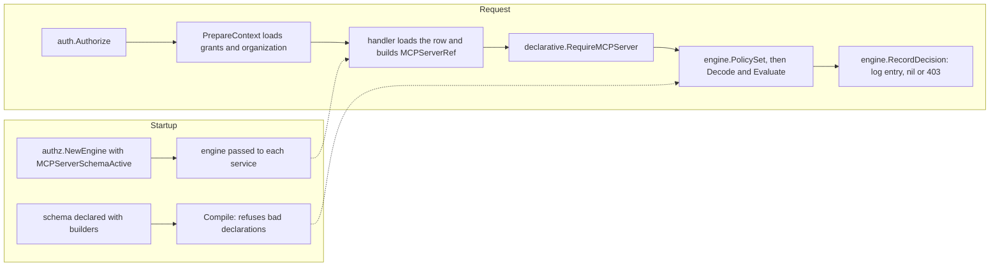

# How option D behaves: a step-by-step guide

This guide grows one step at a time, in the order Tiago asks for them. Each section answers one question about option D. Option D is a declarative relationship schema evaluated over today's `principal_grants` rows. Each section shows the code that expresses the answer, then explains in plain terms what it does when a request arrives.

## How to read it

- **Implemented** means the code is on this branch and covered by tests. The section links the file and the test.
- **Sketched** means the code shows what option D *would* look like. It is not on the branch, or is on it only as far as the example needs. Sketched code may not compile as written.
- Every section ends with what it does *not* cover, and the cases where the answer would change.
- This guide describes option D. It doesn't compare D with other options or recommend it.

## Where the pieces are

| Piece | File | What it does |
| --- | --- | --- |
| Builders and compiler | `relschema/builders.go`, `relschema/schema.go` | `s.NewType`, `s.Grant`, `s.Permission` and so on. `Compile` rejects declarations that don't make sense. |
| Decoder | `relschema/decode.go` | Turns one stored `principal_grants` row into a relationship, or fails. |
| Evaluator | `relschema/eval.go` | Answers allowed, denied or undetermined for one permission on one object, with a trace. |
| Schemas | `mcp_server_schema.go` | The policy for one resource type, written with the builders. |
| Entry points | `mcp_server_access.go` | What services call (`RequireMCPServer`, `MCPServerCapabilities`). |
| Walkthroughs | `walkthroughs/` | A long trace of one request through all of the above. |

## Steps

1. [Scaffolding: how checks are defined, and how handlers reach the authorizer](#step-1-scaffolding)

---

## Step 1: Scaffolding

**Status: implemented** (slice 1, on this branch). This step covers only the frame: where a check is defined, what object handlers hold, how grants reach a request, and what a call looks like. The rules themselves come in later steps.

### 1.1 A check is defined once, in a schema

Today a check is built at each call site from a scope string: `authz.MCPCheck(authz.ScopeMCPConnect, id, projectID)`. In option D, the call site names a **permission on a type**. What that permission means is declared once, in a schema file written with builders:

```go
// mcp_server_schema.go (abridged)
s.NewType("mcp_server", s.Parent("project"), s.StoredKind(authz.ResourceKindMCP),
    s.Grant("connector", s.StoredAs("mcp:connect"), s.AnchoredAt("mcp_server"), ...),
    s.Block("connect_blocked", s.StoredAs("mcp:blocked_connect"), ...),
    s.Permission("connect", s.Union(s.Rel("connector"), root), s.ExcludedBy("connect_blocked")),
)
```

The pieces of a declaration:

- **A type** (`s.NewType`) is a kind of object, with its parent (`s.Parent`). Here an MCP server sits in a project, which sits in an organization.
- **A grant** (`s.Grant`) says which stored scope in `principal_grants` gives which relation (`s.StoredAs`), and where a row may attach (`s.AnchoredAt`).
- **A block** (`s.Block`) is the same for a `blocked_` scope.
- **A permission** (`s.Permission`) is what code asks for. It is computed from relations, never stored.

Code asks for permissions through typed constants, so a call site can't pass a raw scope string:

```go
type MCPServerPermission string

const (
    MCPServerRead    MCPServerPermission = "read"
    MCPServerEdit    MCPServerPermission = "edit"
    MCPServerConnect MCPServerPermission = "connect"
)
```

**The schema is compiled once, at startup.** It is a package-level value, so a bad declaration stops the server from starting:

```go
var mcpServerSchema = mustCompileMCPServerSchema() // panics on error
```

`relschema.Compile` refuses, among other things:

- a parent that doesn't exist, or a chain that doesn't end at the organization;
- an anchor that isn't the type or one of its ancestors;
- a permission that names an unknown relation, or excludes something that isn't a block;
- a stored scope mapped twice;
- **a registered scope that is neither read by the schema nor declared out of it.** Adding a scope to `authz/scopes.go` without deciding where it belongs fails startup.

### 1.2 Handlers keep the client they already have

There is no new client. Option D reuses the existing `*authz.Engine`, which every service already receives through its constructor:

```go
// cmd/gram/start.go
authzEngine := authz.NewEngine(logger, db, challengeLoggingEnabled, roleClient,
    authz.EngineOpts{
        // ...existing admission options...
        // No organization evaluates MCP servers through the relationship schema yet.
        MCPServerSchemaActive: nil,
    })

mcpServersService := mcpservers.NewService(logger, tracerProvider, db, sessionManager, authzEngine, ...)
```

```go
// mcpservers/impl.go
type Service struct {
    // ...
    authz *authz.Engine
}
```

The only new engine option is `MCPServerSchemaActive`, a function that answers "does this organization use the schema?". It is `nil`, meaning no, at all four `cmd/gram` construction sites, so production behavior is unchanged.

The declarative package doesn't wrap or replace the engine. Its functions take the engine as an argument and use a few small hooks it exposes (`authz/policy_set.go`):

| Hook | What it gives the declarative package |
| --- | --- |
| `PolicySet(ctx)` | The caller's loaded grants, grouped by policy, and the organization they were loaded for |
| `MCPServerSchemaActive(ctx)` | Whether the caller's organization is switched on |
| `RecordDecision(ctx, check, decision)` | Writes the same challenge log entry as `Require`, and returns the same 403 |
| `MapError(ctx, err)` | The same error mapping as `Require` |
| `IsAPIKeyGrant(grant)` | Whether a row belongs to a legacy API key, whose rows match strictly |

So policy lives in `declarative/`, while identity, grant loading, logging and error responses stay in the engine.

### 1.3 Grants reach the request the same way as today

Nothing new runs per request before the handler. The Goa security handler, `auth.Authorize` (`internal/auth/auth.go`), authenticates the caller and then calls `s.authz.PrepareContext(ctx)`. This:

- resolves who the caller is (the user and their roles, or an agent's policies);
- loads their `principal_grants` rows into the context;
- records which organization those rows belong to. That last part is new in option D, and lets the evaluator refuse grants loaded for one organization being used in another.

A few MCP serving paths that don't go through Goa call `PrepareContext` themselves, as they already did.

### 1.4 The call shape

A handler loads the object from its own tenant-scoped query, builds a reference from that row, and asks one question:

```go
server := declarative.MCPServerRef{
    ID:             row.ID.String(),
    ProjectID:      row.ProjectID.String(),
    OrganizationID: organizationID,
}
if err := declarative.RequireMCPServer(ctx, s.authz, declarative.MCPServerConnect, server); err != nil {
    return err // already a 403, logged like any other denial
}
```

- **The reference comes from the database, not the request.** `MCPServerRef` carries the server's real project and organization, so the evaluator can check the tenant itself.
- **`RequireMCPServer` enforces a permission.** If the organization isn't switched on, it runs the legacy check unchanged.
- **`MCPServerCapabilities(ctx, s.authz, server)` reports.** It returns `{Read, Edit, Connect}` for API responses, from the same decision function, so what's reported can't drift from what's enforced.

The core types, from the outside in:

| Type | Package | Role |
| --- | --- | --- |
| `MCPServerRef`, `MCPServerPermission`, `Capabilities` | `declarative` | What a handler passes and gets back |
| `authz.PolicySet` | `authz` | The caller's grants, by policy, bound to one organization |
| `relschema.Row` → `relschema.Relationship` | `relschema` | One stored row, and what the schema makes of it (`Decode`) |
| `relschema.Object` | `relschema` | The object being checked, with its ancestors |
| `relschema.Decision` | `relschema` | Allowed, denied or undetermined, with a reason and a trace (`Evaluate`) |



### Not settled by this step

- **Entry points are named per type** (`RequireMCPServer`). With a second type, they'd become one `Require(ctx, engine, permission, ref)`, where the reference names its type. That isn't built.
- **Activation is a callback with no implementation.** Where its answer would come from (a feature flag, an organization column) isn't decided.
- **One schema value per area.** Whether every type goes in one compiled schema, or each area gets its own, is open. With one schema, every row in a policy has to decode for every check.
