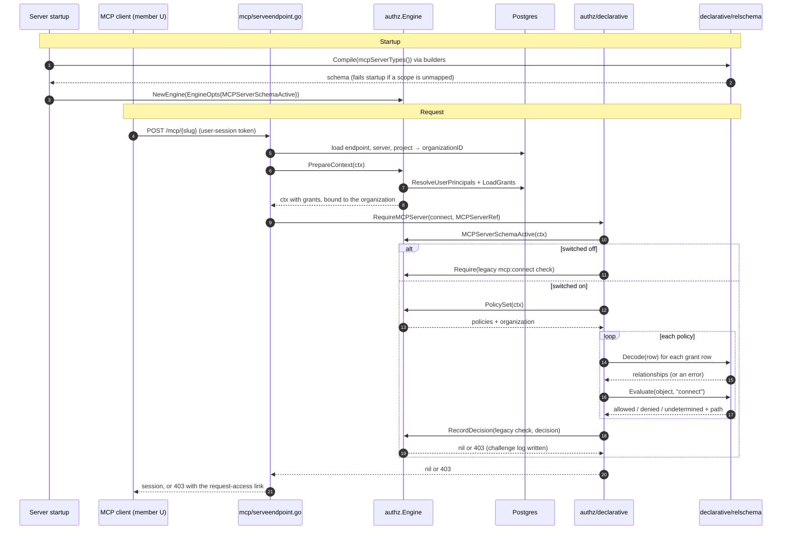
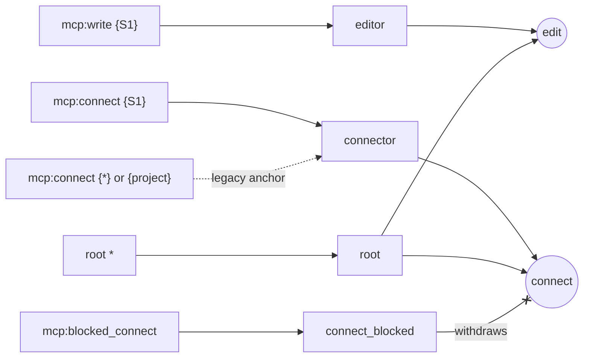

# Option D: one request, step by step

This document follows one request from server startup all the way to a 403. Every snippet is copied from the code and lightly trimmed. Paths are under `server/internal/`.

**The scenario.** Member U holds `mcp:write` on private server S1 in project P1. U tries to start an MCP session on S1 with a user-session token. U's organization has the new schema switched on.

## The whole flow at a glance



How the permissions are computed from stored rows. `editor` feeds `edit` only, so nothing connects an edit grant to `connect`:



---

## Part 1: when the server starts ("configured")

### Step 1. The schema is declared and compiled once, at package init

`authz/declarative/mcp_server_schema.go`

```go
var mcpServerSchema = mustCompileMCPServerSchema()   // panics at startup if the declaration is invalid

func mcpServerTypes() []*s.Type {
	root := s.AncestorRel(org, "root")
	anywhere := s.AnchoredAt(server, project, org)
	...
	s.NewType(server, s.Parent(project), s.StoredKind(authz.ResourceKindMCP),
		s.Grant("editor", s.StoredAs(string(authz.ScopeMCPWrite)), anywhere, s.NarrowableBy(project)),
		s.Grant("connector", s.StoredAs(string(authz.ScopeMCPConnect)), s.AnchoredAt(server), s.LegacyAnchoredAt(project, org),
			s.NarrowableBy(project), toolLimited),
		s.Block("connect_blocked", s.StoredAs(string(authz.ScopeMCPBlockedConnect)), anywhere, s.NarrowableBy(project), toolLimited),
		...
		s.Permission(string(MCPServerEdit), s.Union(s.Rel("editor"), root), s.ExcludedBy("edit_blocked")),
		s.Permission(string(MCPServerConnect), s.Union(s.Rel("connector"), root), s.ExcludedBy("connect_blocked")),
	)
```

The builders only assemble structs. `relschema.Compile` (`relschema/schema.go`) then:

- resolves each containment chain (`mcp_server → project → organization`);
- checks that every anchor is the type itself or one of its ancestors;
- checks that every `ExcludedBy` names a block;
- builds a `scope → relation` index, so the stored scope `mcp:write` maps to `mcp_server.editor`;
- checks that the scope partition is exhaustive:

```go
for _, scope := range def.KnownScopes {          // every authz.RegisteredScopes()
	_, mapped := s.byScope[scope]
	_, out := s.outOfScope[scope]
	if !mapped && !out {
		return nil, fmt.Errorf("scope %q is neither mapped nor declared out of schema", scope)
	}
}
```

**What matters here:** `connect` is `connector ∪ root`. `editor` does not appear in it, and that missing edge is the whole "configure without using" change.

### Step 2. The engine is given the per-organization switch

`cmd/gram/start.go` (and the three other entry points):

```go
authz.EngineOpts{
	...
	// No organization evaluates MCP servers through the relationship schema yet.
	MCPServerSchemaActive: nil,
}
```

In tests, the harness passes a function that returns true (`mcp/setup_test.go`):

```go
MCPServerSchemaActive: func(context.Context, string) (bool, error) { return mcpServerSchema.Load(), nil },
```

---

## Part 2: the request

### Step 3. The endpoint resolves the server and its organization from the database

`mcp/serveendpoint.go`, `prepareProxyBackendContext`

```go
projectWithOrganization, err := projectsrepo.New(s.db).GetProjectWithOrganizationMetadata(ctx, endpoint.ProjectID)
...
organizationID := projectWithOrganization.ID   // trusted: comes from the endpoint's project row, not the request
```

Before this point, the issuer gate has already validated the user-session token and stamped the `AuthContext` with U's user id and organization. That part is unchanged.

### Step 4. The engine loads U's stored grants, and records which organization they belong to

`requireProxyBackendAccess` calls `s.authz.PrepareContext(ctx)`. Inside it, in `authz/engine.go`:

```go
principals, err := ResolveUserPrincipals(ctx, e.db, authCtx.ActiveOrganizationID, authCtx.UserID)  // user:all, user:U, role:…
grants, err := LoadGrants(ctx, e.db, authCtx.ActiveOrganizationID, principals)                     // principal_grants rows
return withPolicyOrganization(GrantsToContext(ctx, grants)), nil                                   // new: bind them to the org
```

`authz/context.go`

```go
func withPolicyOrganization(ctx context.Context) context.Context {
	authCtx, ok := contextvalues.GetAuthContext(ctx)
	...
	return context.WithValue(ctx, policyOrganizationKey{}, authCtx.ActiveOrganizationID)
}
```

For U, the loaded grants hold one row:

```
user:U  mcp:write  {resource_kind: mcp, resource_id: S1}
```

### Step 5. The service names the operation and the object, and nothing more

`mcp/serveendpoint.go`, `requireProxyBackendAccess`

```go
server := declarative.MCPServerRef{ID: mcpServer.ID.String(), ProjectID: projectID.String(), OrganizationID: organizationID}
if err := declarative.RequireMCPServer(ctx, s.authz, declarative.MCPServerConnect, server); err != nil {
	return ctx, fmt.Errorf("authorize MCP server access: %w", mcpaccess.ServerPermissionDenied(err, s.requestAccessURL(...)))
}
```

The service makes no policy decision. It passes the permission (`connect`) and a reference built from trusted rows.

### Step 6. The declarative package takes over

`authz/declarative/mcp_server_access.go`

```go
func RequireMCPServer(ctx context.Context, engine *authz.Engine, permission MCPServerPermission, server MCPServerRef) error {
	scope, err := permission.legacyScope()                       // connect → mcp:connect
	legacy := authz.MCPCheck(scope, server.ID, server.ProjectID)
	active, err := engine.MCPServerSchemaActive(ctx)             // asks the hook from step 2
	if !active {
		return engine.Require(ctx, legacy)                       // switched off: old rules, untouched
	}
	set, err := engine.PolicySet(ctx)                            // step 7
	if !set.Enforced {
		return nil                                               // callers RBAC doesn't apply to, as today
	}
	decision, err := decideMCPServer(set, permission, server) // steps 8–10
	return engine.RecordDecision(ctx, legacy, authz.ExternalDecision{
		Allowed: decision.Allowed, DenyReason: decision.denyReason(), Trace: decision.trace(),
	})                                                           // step 11
}
```

### Step 7. The engine hands over the caller's policies

`authz/policy_set.go`

```go
func (e *Engine) PolicySet(ctx context.Context) (PolicySet, error) {
	enforce, err := e.ShouldEnforce(ctx)
	...
	authorization, ok := grantAuthorizationFromContext(ctx)
	if !ok {
		return PolicySet{Enforced: true}, ErrMissingGrants
	}
	return PolicySet{Enforced: true, OrganizationID: authorization.organizationID, Policies: authorization.policies}, nil
}
```

For a user session, `Policies` holds one set: U's grants. For an agent or credential it can hold several (the credential, the agent and the owner), and every one of them must allow. `OrganizationID` is empty if the request's organization no longer matches the one recorded in step 4.

### Step 8. Build the object with its trusted ancestors, then decode each stored row

`decideMCPServer` (same file). It is pure: no I/O and no context.

```go
if set.OrganizationID == "" {
	// policies loaded for another organization: undetermined, which denies
}
object := relschema.Object{
	Type: typeMCPServer, ID: server.ID,
	Ancestors: []relschema.ObjectRef{
		{Type: typeProject, ID: server.ProjectID},
		{Type: typeOrganization, ID: server.OrganizationID},
	},
}
for _, policy := range set.Policies {
	relationships, err := decodeMCPServerPolicy(set.OrganizationID, policy)
	...
```

`decodeMCPServerPolicy` calls `relschema/decode.go` `Decode` for each row:

```go
target, ok := s.byScope[row.Scope]            // "mcp:write" → mcp_server.editor (index from step 1)
if !ok {
	if _, out := s.outOfScope[row.Scope]; out {
		return Relationship{}, false, nil     // e.g. project:read: another check's business, skipped
	}
	return ..., fmt.Errorf("scope %q has no schema mapping", row.Scope)
}
...
case id != wildcard:
	rel.Anchor = ObjectRef{Type: t.Name, ID: id}   // concrete id → anchored at S1 itself
...
for k := range sel {                               // any leftover selector key must be a declared constraint
	if !slices.Contains(g.Constraints, k) {
		return fail("unsupported selector key %q for %s.%s", k, t.Name, g.Name)
	}
}
```

U's row decodes to:

```
mcp_server:S1#mcp_server.editor from user:U mcp:write {resource_id:S1,resource_kind:mcp}
```

### Step 9. Evaluate the permission

`relschema/eval.go`

```go
func (s *Schema) Evaluate(organizationID string, rels []Relationship, obj Object, perm string, req Request) Decision {
	...
	if reason := s.checkObject(t, obj); reason != "" {          // ancestors must be exactly project, organization
		return Decision{Outcome: Undetermined, Reason: reason}
	}
	if tenant := obj.tenant(s.Root); tenant != organizationID { // fixture row 5
		return Decision{Outcome: Denied, Reason: "object belongs to another organization"}
	}
	switch c.expr(t, obj, p.Expr) { ... }
```

`connect` was compiled to `Minus(Union(Rel("connector"), AncestorRel("organization", "root")), Rel("connect_blocked"))`. Walking it:

```go
case MinusExpr:
	base := c.expr(t, obj, x.Base)   // Union(connector, root)
	if base == triFalse {
		return triFalse              // ← U stops here: no connector or root relationship reaches S1
	}
	...
	sub := c.expr(t, obj, x.Sub)     // connect_blocked
	if sub == triTrue {              // a matching block withdraws the allow, whoever holds it (row 3)
		c.withdrawn = append(c.withdrawn, blockPath...)
		return triFalse
	}
```

`rel()` looks for a relationship of the right relation, anchored at the object or one of its ancestors, that satisfies its narrowing and constraints:

```go
reach := append([]ObjectRef{obj.ref()}, obj.Ancestors...)   // S1, P1, org
for _, r := range c.rels {
	if r.Type != t.Name || r.Grant != g.Name { continue }    // U has "editor", not "connector"
	if !slices.Contains(reach, r.Anchor) { continue }
	if !narrowingHolds(obj, r.Narrowing) { continue }        // e.g. project_id:P1 on a concrete id (row 4)
	if !c.constraintsHold(g, r) { continue }
	c.path = append(c.path, r.String())
	return triTrue
}
```

U's only relationship is `editor`, so `connector` finds nothing, root finds nothing, and the result is:

```
Decision{Outcome: Denied, Reason: "no relationship grants mcp_server.connect"}
```

### Step 10. Combine the policies

Back in `decideMCPServer`:

```go
decision.Allowed = len(set.Policies) > 0
for ... {
	decision := mcpServerSchema.Evaluate(set.OrganizationID, relationships, object, string(permission), relschema.Request{Facts: nil})
	if decision.Outcome != relschema.Allowed {
		decision.Allowed = false   // every policy must allow
	}
}
```

### Step 11. Record the decision and return the same error as before

`authz/policy_set.go`, `RecordDecision`

```go
e.logger.DebugContext(ctx, "external authz decision", ..., attr.SlogReason(decision.Trace))
// trace: "mcp_server:S1 connect allowed=false; policy 0 denied (no relationship grants mcp_server.connect)"
challengeLogger{Outcome: authzrepo.OutcomeDeny, Reason: decision.DenyReason, Checks: []Check{check}, ...}.Log(...)
return e.mapError(ctx, Denied(check.Scope, check.selector()))   // the usual oops CodeForbidden
```

Back in the endpoint (step 5), that error is wrapped in `mcpaccess.ServerPermissionDenied` with the request-access URL (`scope=mcp:connect&resource_id=S1`). U gets the same 403 and the same "request access" message the product shows today. Only the reason changed.

---

## The same server through the configuration path

`mcpservers/impl.go`, `UpdateMcpServer`, for the same member U:

```go
unlocked, err := s.requireServerEditUnlocked(ctx, authCtx.ActiveOrganizationID, serverID, *authCtx.ProjectID, logger)
// → declarative.RequireMCPServer(ctx, s.authz, declarative.MCPServerEdit, serverRef(organizationID, server))
...  // begin transaction, lock the row
if err := declarative.RequireMCPServer(ctx, s.authz, declarative.MCPServerEdit, serverRef(authCtx.ActiveOrganizationID, existing)); err != nil {
	return nil, err   // re-checked against the locked row
}
...
afterView, err = s.withPermissions(ctx, authCtx.ActiveOrganizationID, updated, afterView)
// → declarative.MCPServerCapabilities: the same decideMCPServer, run for read, edit and connect
```

`edit` is `editor ∪ root`, so U's row allows it and the update succeeds. The response carries `permissions: {read: true, edit: true, connect: false}`, which comes from the same steps 7 to 10 that just denied the session.

## What changes the outcome

| Change U's rows to… | Where it bites | Result |
|---|---|---|
| add `mcp:connect {S1}` | step 9: `connector` relationship found | session allowed |
| plus `role:R mcp:blocked_connect {S1}` | step 9: `MinusExpr` sub is true | denied: "withdrawn by a matching block" |
| `mcp:connect {*}` | step 8: anchored at the organization through `LegacyAnchoredAt` | allowed; the trace says "(legacy broad grant)" |
| `mcp:write {S1, tool: x}` | step 8: `tool` is not a declared constraint on `editor` | error (500), never a silent allow or deny |
| organization switched off | step 6 | `engine.Require(legacy)` exactly as today |
